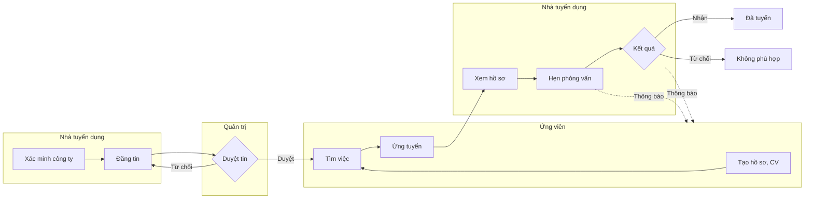

# Đề 5 · App tìm việc

> **Mã:** DE05 · **Độ khó:** 5/8 · **Vai trò:** 3 (ứng viên, nhà tuyển dụng, quản trị) · **Nền tảng:** App ứng viên iOS / Android · Web nhà tuyển dụng · Web quản trị `[giả định]`

Sàn việc làm hai phía: ứng viên tạo hồ sơ, tìm việc và ứng tuyển; nhà tuyển dụng đăng tin, lọc hồ sơ và hẹn phỏng vấn; quản trị duyệt tin để chặn tin lừa đảo. Đây là đề đầu tiên có **ba vai trò trên hai nền tảng** và một **luồng kiểm duyệt**. Đề gồm 4 tính năng; mỗi tính năng có 1 PRD và 1 SRS riêng.

## Tính năng

| **Mã** | **Tính năng** | **Phạm vi** | **PRD** | **SRS** |
| --- | --- | --- | --- | --- |
| TN01 | Tạo hồ sơ & CV | Hồ sơ ứng viên theo từng phần, tải CV, độ hoàn thiện hồ sơ, chế độ hiển thị | [PRD](docs/TN01-ho-so-cv/PRD.md) | [SRS](docs/TN01-ho-so-cv/SRS.md) |
| TN02 | Tìm việc & ứng tuyển | Tìm kiếm, bộ lọc, chi tiết tin, lưu tin, ứng tuyển, theo dõi trạng thái đơn | [PRD](docs/TN02-tim-viec-ung-tuyen/PRD.md) | [SRS](docs/TN02-tim-viec-ung-tuyen/SRS.md) |
| TN03 | Đăng tin & kiểm duyệt | Nhà tuyển dụng xác minh công ty, đăng tin; quản trị duyệt, từ chối, gỡ tin; báo cáo tin | [PRD](docs/TN03-dang-tin-kiem-duyet/PRD.md) | [SRS](docs/TN03-dang-tin-kiem-duyet/SRS.md) |
| TN04 | Xử lý hồ sơ & hẹn phỏng vấn | Pipeline ứng viên, đổi trạng thái, ghi chú, hẹn lịch phỏng vấn, thông báo hai chiều | [PRD](docs/TN04-xu-ly-ho-so-phong-van/PRD.md) | [SRS](docs/TN04-xu-ly-ho-so-phong-van/SRS.md) |

Thứ tự làm gợi ý: TN01 → TN03 → TN02 → TN04 (cần có tin đã duyệt thì ứng viên mới tìm được việc).

## Vòng đời dùng chung



## Bối cảnh chung

Người tìm việc mất nhiều thời gian lọc tin trùng, tin không ghi lương, và sợ tin lừa đảo (thu phí, việc nhẹ lương cao). Nhà tuyển dụng nhỏ nhận nhiều hồ sơ không phù hợp và khó theo dõi ứng viên qua email. Bài toán thiết kế là làm sao để **cả hai phía tin nhau**: tin đăng rõ ràng, đã duyệt; ứng viên luôn biết hồ sơ của mình đang ở đâu.

| **Nhóm người dùng** | **Nhu cầu chính** |
| --- | --- |
| Sinh viên mới ra trường | Tìm việc phù hợp ít kinh nghiệm, biết lương trước khi ứng tuyển |
| Người đi làm muốn đổi việc | Tìm kín đáo, không để công ty hiện tại thấy hồ sơ |
| Lao động phổ thông | Ứng tuyển nhanh trên điện thoại, không cần CV đẹp |
| Nhà tuyển dụng doanh nghiệp nhỏ | Đăng tin nhanh, lọc hồ sơ, hẹn phỏng vấn trong một chỗ |
| Đội kiểm duyệt | Duyệt nhanh, phát hiện tin lừa đảo |

Ngoài phạm vi cả đề: gói đăng tin trả phí và thanh toán, màn tìm kiếm ứng viên và liên hệ chủ động phía nhà tuyển dụng (headhunt), chấm điểm CV bằng AI, gọi video phỏng vấn trong app, nhắn tin tự do giữa hai bên, bài test năng lực.

Riêng chế độ "Cho nhà tuyển dụng tìm thấy" và chặn công ty ở TN01: đề chỉ gồm phần **cài đặt phía ứng viên** (lưu lựa chọn và sự đồng ý). Màn tìm ứng viên phía nhà tuyển dụng thuộc phase sau; khi có, màn đó phải tuân theo BR-09, BR-10 `[giả định]`.

## Quy ước dùng chung

- Màn App ứng viên mã `SCR-U..`, Web nhà tuyển dụng `SCR-N..`, Web quản trị `SCR-A..`.
- Đăng ký, đăng nhập dùng luồng chuẩn (số điện thoại, email, Google), không mô tả trong bộ tài liệu này.
- Mức lương VND/tháng, hiển thị rút gọn "15–20 triệu".
- Mã BR, MSG, UC đánh số liên tục trong cả đề: TN01 dùng BR-01–10, MSG-01–08; TN02 dùng BR-11–22, MSG-09–18; TN03 dùng BR-23–35, MSG-19–30; TN04 dùng BR-36–47, MSG-31–42. Mã bổ sung sau đánh tiếp từ số cuối: MSG-43 (thông báo đẩy khi đơn đổi trạng thái) nằm ở SRS TN02.
- Giá trị đánh dấu `[giả định]` dùng để dựng flow, cần PO hoặc BA xác nhận trước khi dùng.

## Danh sách màn hình

| **Mã** | **Màn hình** | **Nền tảng** | **Mô tả chi tiết ở** |
| --- | --- | --- | --- |
| SCR-U01 | Hồ sơ của tôi | App ứng viên | SRS TN01 |
| SCR-U02 | Sửa một phần hồ sơ | App ứng viên | SRS TN01 |
| SCR-U03 | Quản lý CV | App ứng viên | SRS TN01 |
| SCR-U04 | Tìm việc | App ứng viên | SRS TN02 |
| SCR-U05 | Bộ lọc | App ứng viên | SRS TN02 |
| SCR-U06 | Chi tiết tin | App ứng viên | SRS TN02 |
| SCR-U07 | Ứng tuyển | App ứng viên | SRS TN02 |
| SCR-U08 | Việc đã ứng tuyển | App ứng viên | SRS TN02 |
| SCR-U09 | Chi tiết đơn & lịch phỏng vấn | App ứng viên | SRS TN04 |
| SCR-N01 | Hồ sơ & xác minh công ty | Web nhà tuyển dụng | SRS TN03 |
| SCR-N02 | Danh sách tin | Web nhà tuyển dụng | SRS TN03 |
| SCR-N03 | Soạn tin | Web nhà tuyển dụng | SRS TN03 |
| SCR-N04 | Pipeline ứng viên | Web nhà tuyển dụng | SRS TN04 |
| SCR-N05 | Chi tiết ứng viên | Web nhà tuyển dụng | SRS TN04 |
| SCR-N06 | Hẹn phỏng vấn | Web nhà tuyển dụng | SRS TN04 |
| SCR-A01 | Hàng đợi kiểm duyệt | Web quản trị | SRS TN03 |
| SCR-A02 | Chi tiết duyệt tin | Web quản trị | SRS TN03 |
| SCR-A03 | Báo cáo vi phạm | Web quản trị | SRS TN03 |

## Cấu trúc repo

```text
de05-app-tim-viec/
├── README.md
└── docs/
    ├── TN01-ho-so-cv/                PRD.md · SRS.md
    ├── TN02-tim-viec-ung-tuyen/      PRD.md · SRS.md
    ├── TN03-dang-tin-kiem-duyet/     PRD.md · SRS.md
    └── TN04-xu-ly-ho-so-phong-van/   PRD.md · SRS.md
```

## Cách dùng bộ tài liệu

1. Đọc README để nắm ba vai trò và vòng đời dùng chung.
2. Với mỗi tính năng: đọc PRD, rồi SRS. Với mỗi trạng thái, thiết kế màn cho **mọi vai trò** thấy trạng thái đó.
3. Thiết kế màn hình theo đúng mã SCR, mã MSG trong SRS để dễ đối chiếu khi review.
4. Sơ đồ viết bằng Mermaid, xem trực tiếp trên GitHub hoặc trình xem Markdown có hỗ trợ Mermaid.
