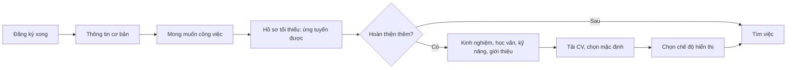

> **Mã:** DE05-TN01-PRD · **Trạng thái:** nháp · **Người viết:** Design (mock) · **SRS:** [SRS.md](SRS.md)

# PRD Tạo hồ sơ và CV (App tìm việc)

> **Bản mock.** Con số đánh dấu `[giả định]` dùng để dựng flow, cần PO xác nhận trước khi dùng.

## 1. Bối cảnh và vấn đề

### 1.1 Bối cảnh

Hồ sơ là thứ nhà tuyển dụng nhìn thấy đầu tiên khi ứng viên ứng tuyển (xem [README](../../README.md)). Nhiều ứng viên, nhất là sinh viên và lao động phổ thông, không có CV soạn sẵn hoặc chỉ có trên máy tính. Tính năng này giúp ứng viên có một hồ sơ đủ dùng ngay trên điện thoại, và kiểm soát ai được thấy hồ sơ đó.

### 1.2 Vấn đề

| **Vấn đề** | **Hệ quả** |
| --- | --- |
| Form hồ sơ dài, bắt điền hết một lần | Bỏ dở, không ứng tuyển được |
| Không có CV file trên điện thoại | Không ứng tuyển được tin yêu cầu CV |
| Không biết hồ sơ đã đủ tốt chưa | Hồ sơ sơ sài, ít được gọi |
| Hồ sơ công khai cho mọi công ty | Người đang đi làm sợ công ty hiện tại thấy |
| Thông tin cá nhân lộ ra ngoài | Bị gọi điện quảng cáo, lừa đảo |

### 1.3 Mục tiêu

- ≥ 70% ứng viên mới có hồ sơ đủ để ứng tuyển trong ngày đầu `[giả định]`.
- Thời gian tạo hồ sơ tối thiểu ≤ 5 phút `[giả định]`.
- Không có số điện thoại, email ứng viên hiển thị cho nhà tuyển dụng khi ứng viên chưa ứng tuyển.

## 2. Người dùng

| **Nhóm** | **Nhu cầu với tính năng này** |
| --- | --- |
| Sinh viên mới ra trường | Hồ sơ có học vấn, dự án, kỹ năng thay cho kinh nghiệm |
| Người đi làm muốn đổi việc | Ẩn hồ sơ với công ty hiện tại |
| Lao động phổ thông | Hồ sơ ngắn, không cần file CV |

## 3. Phạm vi

### 3.1 Trong phạm vi (MVP)

- Hồ sơ theo phần: Thông tin cơ bản, Mong muốn công việc, Kinh nghiệm, Học vấn, Kỹ năng, Giới thiệu.
- Hồ sơ tối thiểu để ứng tuyển: thông tin cơ bản và mong muốn công việc.
- Độ hoàn thiện hồ sơ và gợi ý phần nên bổ sung.
- Tải lên tối đa 3 file CV (PDF, DOCX), chọn CV mặc định.
- Chế độ hiển thị: Chỉ khi ứng tuyển (mặc định), hoặc Cho nhà tuyển dụng tìm thấy.
- Chặn công ty cụ thể không thấy hồ sơ.

### 3.2 Ngoài phạm vi

- Tạo CV từ mẫu, xuất PDF → phase sau.
- Đọc CV tự động để điền hồ sơ.
- Video giới thiệu bản thân.
- Xác minh bằng cấp.

## 4. Nguyên tắc sản phẩm

### 4.1 Đủ để ứng tuyển, rồi hoàn thiện dần

Chỉ cần vài phần cơ bản là ứng tuyển được. Các phần khác được gợi ý sau, không chặn.

### 4.2 Từng phần một

Mỗi phần sửa ở một màn riêng, lưu riêng. Không có form dài một trang.

### 4.3 Ứng viên quyết định ai được xem

Mặc định hồ sơ chỉ hiện với công ty mà ứng viên đã ứng tuyển. Liên hệ chỉ hiện sau khi ứng tuyển.

### 4.4 Gợi ý cụ thể

Độ hoàn thiện đi kèm việc cần làm ("Thêm kỹ năng để tăng khả năng được gọi"), không chỉ là phần trăm.

## 5. Quy tắc nghiệp vụ

| **Quy tắc** | **Giá trị** `[giả định]` |
| --- | --- |
| Hồ sơ tối thiểu | Họ tên, năm sinh, khu vực, số điện thoại đã xác minh; vị trí mong muốn, mức lương mong muốn |
| Kinh nghiệm | Tối đa 10 mục; có tuỳ chọn "Chưa có kinh nghiệm" |
| Kỹ năng | Tối đa 20, chọn từ danh sách gợi ý hoặc tự nhập |
| CV | Tối đa 3 file, PDF hoặc DOCX, ≤ 5 MB mỗi file |
| Độ hoàn thiện | Tính theo trọng số từng phần, 0–100% |
| Hiển thị | Chỉ khi ứng tuyển (mặc định) hoặc Cho nhà tuyển dụng tìm thấy |
| Chặn công ty | Tối đa 20 công ty |

- Các giá trị trên là **cấu hình**, không cố định trong code.

## 6. Luồng trải nghiệm

| **Bước** | **Giai đoạn** | **Trải nghiệm** | **Đầu ra** |
| --- | --- | --- | --- |
| 1 | Bắt đầu | Sau đăng ký, mời tạo hồ sơ 2 bước | Bắt đầu hồ sơ |
| 2 | Thông tin cơ bản | Họ tên, năm sinh, khu vực; số điện thoại lấy từ tài khoản | Phần 1 xong |
| 3 | Mong muốn | Vị trí, ngành, mức lương, hình thức làm việc | Hồ sơ tối thiểu |
| 4 | Hoàn thiện | Từng phần còn lại, theo gợi ý | Hồ sơ đầy đủ hơn |
| 5 | CV | Tải lên từ điện thoại hoặc Google Drive | CV mặc định |
| 6 | Quyền riêng tư | Chọn hiển thị, chặn công ty | Kiểm soát hồ sơ |

## 7. Use Cases, User Stories và Acceptance Criteria

### UC1. Tạo và sửa hồ sơ

#### US1.1 Tạo hồ sơ tối thiểu

User Story: Là ứng viên mới, tôi muốn tạo hồ sơ nhanh để ứng tuyển ngay.

AC01: Sau đăng ký hiện 2 bước: Thông tin cơ bản, Mong muốn công việc; có thanh bước.

AC02: Xong 2 bước → báo "Bạn đã có thể ứng tuyển", gợi ý hoàn thiện thêm.

AC03: Thoát giữa chừng → phần đã điền được lưu.

#### US1.2 Hoàn thiện từng phần

User Story: Là ứng viên, tôi muốn hoàn thiện hồ sơ từng phần khi rảnh để hồ sơ tốt hơn mà không mất công một lần.

AC01: Màn Hồ sơ hiện các phần dạng thẻ; phần trống có nút "Thêm".

AC02: Mỗi phần sửa ở màn riêng, có nút Lưu; rời màn khi chưa lưu thì hỏi.

AC03: Kinh nghiệm: chức danh, công ty, thời gian, mô tả; có "Đang làm ở đây".

AC04: Chọn "Chưa có kinh nghiệm" → ẩn phần Kinh nghiệm, gợi ý thêm dự án ở Học vấn.

#### US1.3 Biết hồ sơ đã tốt chưa

User Story: Là ứng viên, tôi muốn biết nên thêm gì vào hồ sơ để tăng khả năng được gọi.

AC01: Độ hoàn thiện hiện bằng phần trăm và thanh tiến độ.

AC02: Kèm tối đa 3 gợi ý cụ thể, chạm để mở đúng phần cần thêm.

### UC2. Quản lý CV

#### US2.1 Tải và chọn CV

User Story: Là ứng viên, tôi muốn tải lên và chọn CV mặc định để ứng tuyển tin yêu cầu CV.

AC01: Tải file từ điện thoại, Google Drive; chỉ PDF, DOCX ≤ 5 MB.

AC02: Tối đa 3 CV; đặt tên được; chọn 1 CV mặc định.

AC03: Xem trước CV trong app.

AC04: Xoá CV đang được dùng trong đơn ứng tuyển → đơn đó vẫn giữ bản đã gửi.

### UC3. Quyền riêng tư hồ sơ

#### US3.1 Chọn ai được xem

User Story: Là người đang đi làm, tôi muốn kiểm soát ai thấy hồ sơ để không lộ việc tôi đang tìm việc.

AC01: Hai chế độ: "Chỉ khi tôi ứng tuyển" (mặc định), "Cho nhà tuyển dụng tìm thấy".

AC02: Số điện thoại, email chỉ hiện với công ty ứng viên đã ứng tuyển.

AC03: Chặn công ty theo tên; công ty bị chặn không thấy hồ sơ dù ứng viên chọn cho tìm thấy.

## 8. Chỉ số theo dõi `[giả định]`

| **Chỉ số** | **Định nghĩa** | **Mục tiêu MVP** |
| --- | --- | --- |
| Tỉ lệ có hồ sơ tối thiểu | Ứng viên có hồ sơ tối thiểu trong ngày đầu / ứng viên mới | ≥ 70% |
| Thời gian tạo hồ sơ tối thiểu | Từ bắt đầu tới xong bước 2 | ≤ 5 phút (trung vị) |
| Độ hoàn thiện trung bình | Trung bình của ứng viên hoạt động | ≥ 60% |
| Tỉ lệ có CV | Ứng viên có ≥ 1 CV / ứng viên hoạt động | Theo dõi |
| Tỉ lệ cho tìm thấy | Ứng viên chọn cho nhà tuyển dụng tìm thấy / ứng viên hoạt động | Theo dõi |
| Tương quan hồ sơ – phản hồi | Tỉ lệ được xem hồ sơ theo nhóm độ hoàn thiện | Theo dõi |

## 9. Phụ thuộc và rủi ro

| **Mục** | **Mô tả** | **Hướng xử lý** |
| --- | --- | --- |
| File CV chứa mã độc | Nhà tuyển dụng tải về bị nhiễm | Quét file khi tải lên; chỉ PDF, DOCX |
| Lộ thông tin cá nhân | Liên hệ bị thu thập hàng loạt | Liên hệ chỉ hiện sau khi ứng tuyển; giới hạn xem |
| Danh mục ngành, kỹ năng | Phải có sẵn, đủ tiếng Việt | Đội nội dung cung cấp; cho tự nhập |
| Gợi ý gây áp lực | Ứng viên lao động phổ thông thấy hồ sơ "chưa tốt" | Trọng số khác theo nhóm ngành `[cần chốt]` |

## 10. Câu hỏi mở

- Hồ sơ tối thiểu có cần số điện thoại đã xác minh không?
- Có cho ứng tuyển không cần hồ sơ (chỉ CV) không?
- Độ hoàn thiện có hiện cho nhà tuyển dụng không?
- Có cần nhiều hồ sơ cho nhiều hướng nghề khác nhau?
