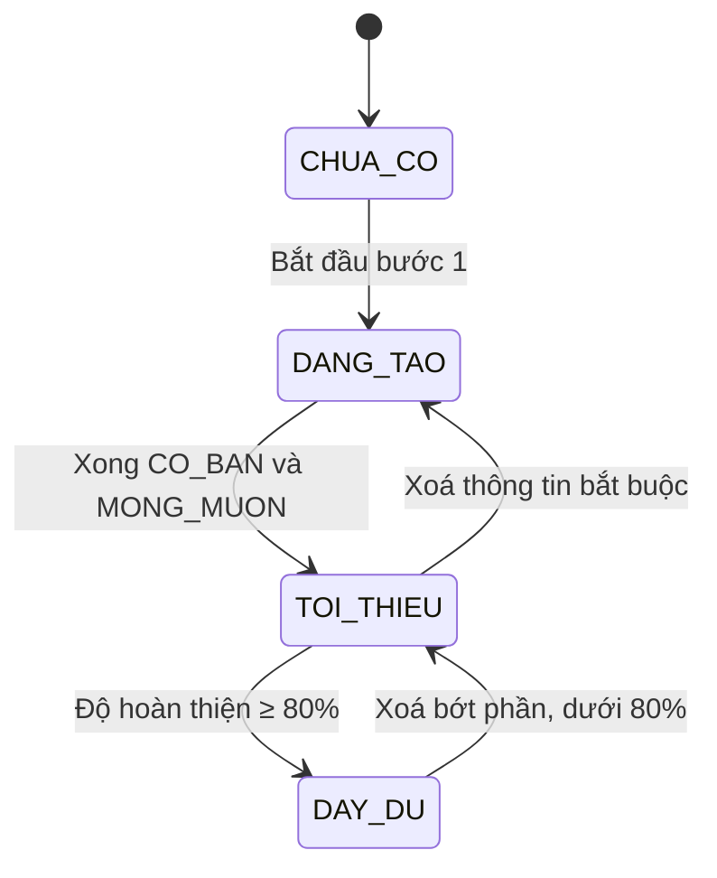
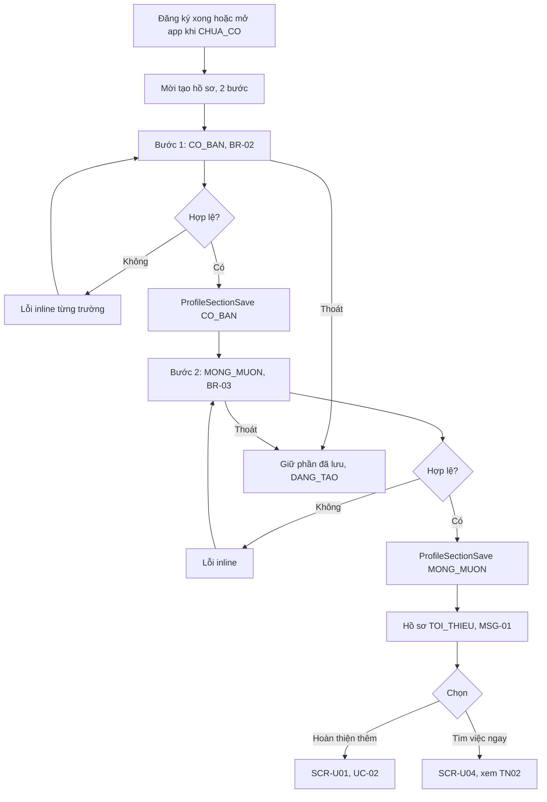
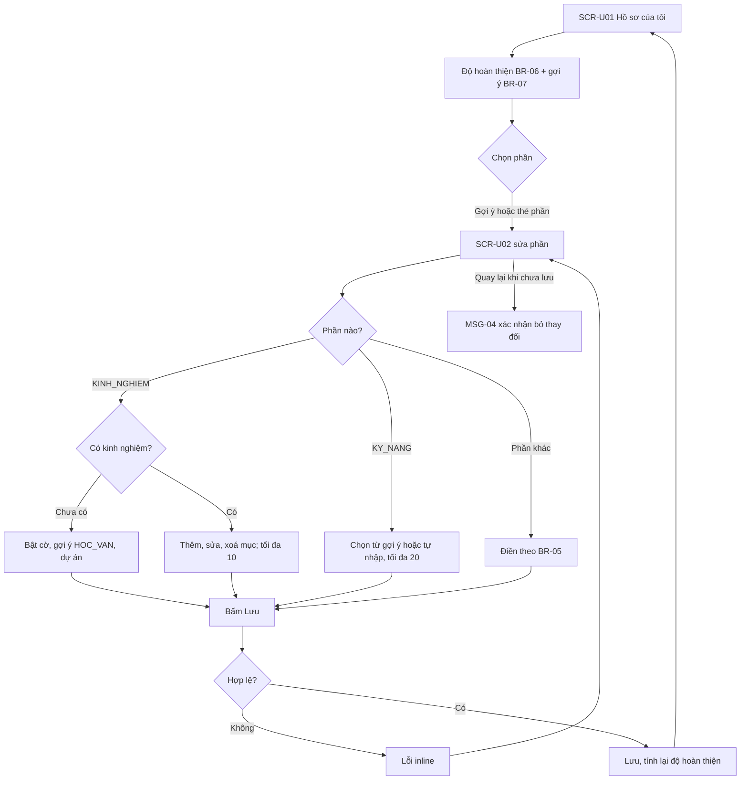
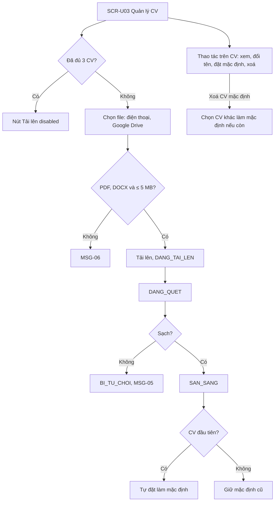
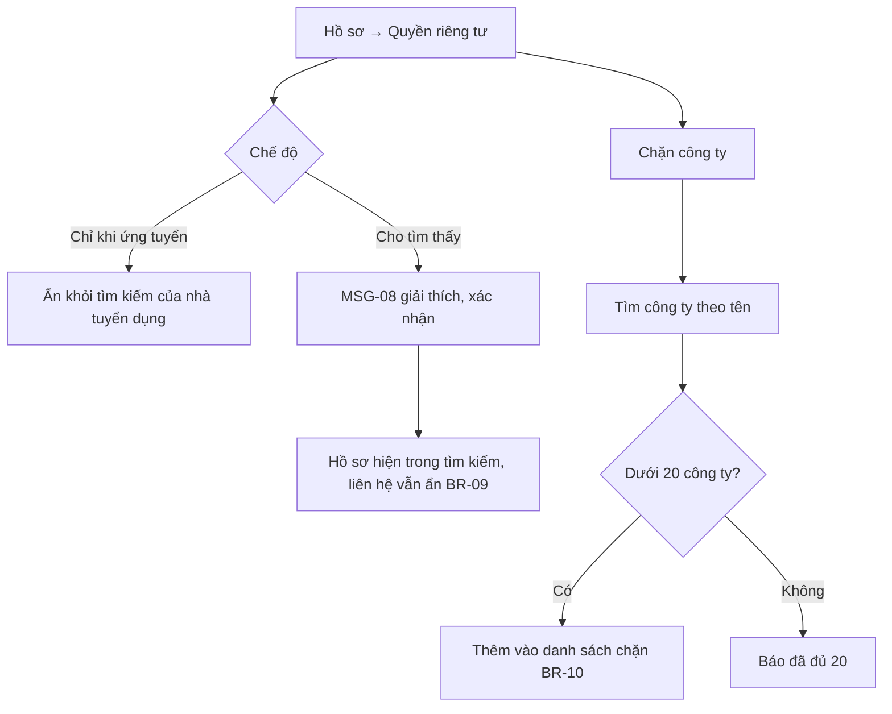
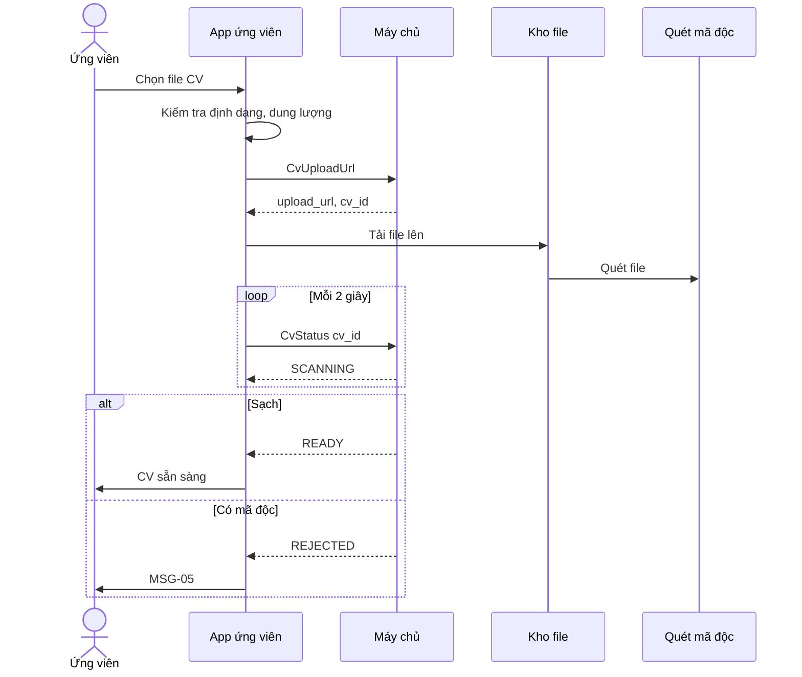

> **Mã:** DE05-TN01-SRS · **Trạng thái:** nháp · **Người viết:** Design (mock) · **PRD:** [PRD.md](PRD.md)

# UC-DE05-01 - Tạo hồ sơ và CV

> **Bản mock.** Giá trị `[giả định]` cần BA xác nhận. Ứng tuyển dùng hồ sơ và CV xem [SRS TN02](../TN02-tim-viec-ung-tuyen/SRS.md).

## 1. Tổng quan

| **Mục** | **Nội dung** |
| --- | --- |
| Mục tiêu | Ứng viên tạo hồ sơ theo từng phần, quản lý CV và kiểm soát ai được xem hồ sơ |
| Actor | Ứng viên · App ứng viên · Máy chủ · Dịch vụ quét file |
| Phạm vi | Onboarding hồ sơ, sửa từng phần, độ hoàn thiện, CV, chế độ hiển thị, chặn công ty |
| Ngoài phạm vi | Tạo CV từ mẫu, đọc CV tự động, video giới thiệu, xác minh bằng cấp |
| Nền tảng | App ứng viên iOS / Android `[giả định]` |
| Figma | `[chưa có]` |

## 2. User Story

| **ID** | **As a** | **I want** | **So that** |
| --- | --- | --- | --- |
| US-01 | Ứng viên mới | Tạo hồ sơ tối thiểu trong vài phút | Ứng tuyển ngay |
| US-02 | Ứng viên | Hoàn thiện từng phần khi rảnh | Hồ sơ tốt hơn mà không mất công một lần |
| US-03 | Ứng viên | Biết nên thêm gì vào hồ sơ | Tăng khả năng được gọi |
| US-04 | Ứng viên | Tải lên và chọn CV mặc định | Ứng tuyển tin yêu cầu CV |
| US-05 | Người đang đi làm | Ẩn hồ sơ, chặn công ty hiện tại | Tìm việc kín đáo |

## 3. Business Rules

| **Mã** | **Quy tắc** |
| --- | --- |
| BR-01 | **Phần hồ sơ**: `CO_BAN`, `MONG_MUON`, `KINH_NGHIEM`, `HOC_VAN`, `KY_NANG`, `GIOI_THIEU`. Mỗi phần lưu độc lập |
| BR-02 | **`CO_BAN`**: họ tên (2–50 ký tự), năm sinh (16–70 tuổi), giới tính (tuỳ chọn), khu vực (tỉnh/thành, quận/huyện), số điện thoại lấy từ tài khoản đã xác minh OTP, email (tuỳ chọn) |
| BR-03 | **`MONG_MUON`**: vị trí mong muốn (1–3 chức danh), ngành (1–3), mức lương mong muốn (khoảng hoặc "Thoả thuận"), hình thức (toàn thời gian, bán thời gian, thời vụ, thực tập), khu vực làm việc (1–3) |
| BR-04 | **Hồ sơ tối thiểu** = `CO_BAN` và `MONG_MUON` hợp lệ. Chưa có hồ sơ tối thiểu thì không ứng tuyển được (SRS TN02) |
| BR-05 | **`KINH_NGHIEM`**: tối đa 10 mục; mỗi mục: chức danh, công ty, từ tháng, đến tháng hoặc "Đang làm", mô tả ≤ 1.000 ký tự. Cờ "Chưa có kinh nghiệm" thay cho danh sách. **`HOC_VAN`**: tối đa 5 mục. **`KY_NANG`**: tối đa 20. **`GIOI_THIEU`**: ≤ 1.000 ký tự |
| BR-06 | **Độ hoàn thiện** = tổng trọng số phần đã có: `CO_BAN` 20, `MONG_MUON` 20, `KINH_NGHIEM` 20 (hoặc cờ Chưa có kinh nghiệm + `HOC_VAN` có ≥ 1 mục), `HOC_VAN` 15, `KY_NANG` 15 (≥ 3 kỹ năng), `GIOI_THIEU` 10 `[giả định]` |
| BR-07 | **Gợi ý**: tối đa 3 phần thiếu có trọng số cao nhất, mỗi gợi ý mở thẳng màn sửa phần đó |
| BR-08 | **CV**: tối đa 3 file; PDF hoặc DOCX; ≤ 5 MB; tên hiển thị ≤ 50 ký tự; đúng 1 CV mặc định khi có ≥ 1 CV. File được quét; nhiễm mã độc → từ chối (MSG-05) |
| BR-09 | **Hiển thị**: `CHI_KHI_UNG_TUYEN` (mặc định) hoặc `CHO_TIM_THAY`. Số điện thoại, email chỉ hiện cho nhà tuyển dụng của tin ứng viên đã ứng tuyển, trong mọi chế độ |
| BR-10 | **Chặn công ty**: tối đa 20; công ty bị chặn không thấy hồ sơ ở mọi chế độ, trừ đơn ứng viên chủ động gửi cho chính công ty đó |

## 4. Trạng thái

### 4.1 Trạng thái hồ sơ

| **Trạng thái** | **Điều kiện** | **Ảnh hưởng** |
| --- | --- | --- |
| `CHUA_CO` | Chưa điền gì | Mời tạo hồ sơ khi mở app |
| `DANG_TAO` | Thiếu `CO_BAN` hoặc `MONG_MUON` | Không ứng tuyển được; banner "Hoàn tất hồ sơ để ứng tuyển" |
| `TOI_THIEU` | Có hồ sơ tối thiểu, độ hoàn thiện < 80% | Ứng tuyển được; hiện gợi ý BR-07 |
| `DAY_DU` | Độ hoàn thiện ≥ 80% `[giả định]` | Nhãn "Hồ sơ tốt" |

### 4.2 Trạng thái một file CV

`DANG_TAI_LEN` → `DANG_QUET` → `SAN_SANG` · nhánh lỗi: `DANG_QUET` → `BI_TU_CHOI` (mã độc, sai định dạng).

## 5. Use Case

### UC-01 Tạo hồ sơ tối thiểu

| **Mục** | **Nội dung** |
| --- | --- |
| Tiền điều kiện | Ứng viên đã đăng nhập, hồ sơ `CHUA_CO` hoặc `DANG_TAO` |
| Hậu điều kiện thành công | Hồ sơ `TOI_THIEU` |
| Hậu điều kiện thất bại | Hồ sơ `DANG_TAO`, giữ phần đã lưu |

**Luồng chính**

| **Bước** | **Actor** | **Mô tả** |
| --- | --- | --- |
| 1 | App | Sau đăng ký, mở onboarding hồ sơ 2 bước |
| 2 | Ứng viên | Điền `CO_BAN`; số điện thoại đã điền sẵn, không sửa ở đây |
| 3 | App | Kiểm tra BR-02, lưu (\[ProfileSectionSave\]) |
| 4 | Ứng viên | Điền `MONG_MUON`; chọn vị trí, ngành từ gợi ý |
| 5 | App | Kiểm tra BR-03, lưu; hồ sơ `TOI_THIEU`; hiện MSG-01 |

**Luồng thay thế**

| **Mã** | **Điều kiện** | **Xử lý** |
| --- | --- | --- |
| A1 | Thoát giữa chừng | Giữ phần đã lưu; lần mở sau tiếp tục ở bước còn thiếu |
| A2 | Vị trí không có trong gợi ý | Cho tự nhập, ≤ 50 ký tự |
| A3 | Chọn "Thoả thuận" cho mức lương | Bỏ trống khoảng lương |

**Luồng lỗi**

| **Mã** | **Điều kiện** | **Xử lý** |
| --- | --- | --- |
| E1 | Năm sinh ngoài 16–70 tuổi | MSG-02 |
| E2 | Lưu thất bại | MSG-03, giữ dữ liệu trên màn |

### UC-02 Hoàn thiện hồ sơ theo phần

| **Mục** | **Nội dung** |
| --- | --- |
| Tiền điều kiện | Hồ sơ đã bắt đầu |
| Hậu điều kiện | Phần được lưu; độ hoàn thiện, gợi ý cập nhật |

**Luồng chính**

| **Bước** | **Actor** | **Mô tả** |
| --- | --- | --- |
| 1 | Ứng viên | Mở **SCR-U01** |
| 2 | App | Hiện thẻ các phần, độ hoàn thiện, tối đa 3 gợi ý |
| 3 | Ứng viên | Chạm phần cần sửa hoặc gợi ý |
| 4 | App | Mở **SCR-U02** cho phần đó |
| 5 | Ứng viên | Điền, bấm Lưu |
| 6 | App | Kiểm tra BR-05, lưu, quay lại **SCR-U01** với độ hoàn thiện mới |

**Luồng thay thế**

| **Mã** | **Điều kiện** | **Xử lý** |
| --- | --- | --- |
| A1 | Quay lại khi chưa lưu | MSG-04 |
| A2 | Đủ giới hạn số mục | Nút "Thêm" disabled kèm số tối đa |
| A3 | Mục kinh nghiệm "Đang làm" | Ẩn trường đến tháng |
| A4 | Độ hoàn thiện đạt 80% | Nhãn "Hồ sơ tốt", MSG-07 |

### UC-03 Quản lý CV

| **Mục** | **Nội dung** |
| --- | --- |
| Tiền điều kiện | Không có |
| Hậu điều kiện | CV `SAN_SANG`; có đúng 1 CV mặc định khi có CV |

### UC-04 Chọn chế độ hiển thị và chặn công ty

| **Mục** | **Nội dung** |
| --- | --- |
| Tiền điều kiện | Hồ sơ `TOI_THIEU` trở lên |
| Hậu điều kiện | Chế độ hiển thị và danh sách chặn được lưu, áp dụng ngay |

## 6. Điểm vào

| **Điểm vào** | **Nền tảng** | **Dẫn tới** | **Ghi chú** |
| --- | --- | --- | --- |
| Đăng ký xong | App ứng viên | UC-01 |  |
| Tab Hồ sơ | App ứng viên | UC-02, **SCR-U01** |  |
| Banner "Hoàn tất hồ sơ để ứng tuyển" | App ứng viên | UC-01 | Khi ứng tuyển lúc chưa có hồ sơ tối thiểu (SRS TN02) |
| "Thêm CV" ở màn ứng tuyển | App ứng viên | UC-03 | SRS TN02 |
| Hồ sơ → CV | App ứng viên | UC-03, **SCR-U03** |  |
| Hồ sơ → Quyền riêng tư | App ứng viên | UC-04 |  |

## 7. Mô tả màn hình

### SCR-U01 Hồ sơ của tôi

| **#** | **Thành phần** | **Loại** | **Hành vi** |
| --- | --- | --- | --- |
| 1 | Đầu hồ sơ | Header | Ảnh đại diện (tuỳ chọn), họ tên, vị trí mong muốn, khu vực |
| 2 | Độ hoàn thiện | Progress | "{x}%" + nhãn trạng thái hồ sơ |
| 3 | Gợi ý | List | Tối đa 3 (BR-07); chạm mở **SCR-U02** |
| 4 | Thẻ phần | Cards | Mỗi phần: tóm tắt nội dung hoặc "Thêm {phần}"; chạm mở **SCR-U02** |
| 5 | CV | Card | Số CV, CV mặc định; chạm mở **SCR-U03** |
| 6 | Quyền riêng tư | Dòng | Chế độ hiện tại; chạm mở cài đặt |
| 7 | Xem như nhà tuyển dụng | Button text | Xem trước hồ sơ như nhà tuyển dụng thấy (ẩn liên hệ) |

### SCR-U02 Sửa một phần hồ sơ

| **#** | **Thành phần** | **Loại** | **Bắt buộc** | **Validate / hành vi** |
| --- | --- | --- | --- | --- |
| 1 | Tiêu đề phần | Header | – | Nút Quay lại (MSG-04 nếu có thay đổi) |
| 2 | Trường của phần | Theo phần | Theo BR-02, BR-03, BR-05 | Lỗi inline dưới từng trường |
| 3 | Danh sách mục | List | – | Với `KINH_NGHIEM`, `HOC_VAN`: thêm, sửa, xoá, sắp xếp mới nhất trước |
| 4 | "Chưa có kinh nghiệm" | Checkbox | – | Chỉ ở `KINH_NGHIEM` |
| 5 | Lưu | Button | – | Disabled khi chưa có thay đổi hoặc chưa hợp lệ |

### SCR-U03 Quản lý CV

| **#** | **Thành phần** | **Loại** | **Hành vi** |
| --- | --- | --- | --- |
| 1 | Danh sách CV | List | Tên, ngày tải, dung lượng, nhãn "Mặc định", trạng thái file |
| 2 | Menu mỗi CV | Menu | Xem, Đổi tên, Đặt làm mặc định, Xoá |
| 3 | Tải CV lên | Button | Disabled khi đủ 3 (BR-08) |
| 4 | Ghi chú | Text phụ | "PDF hoặc DOCX, tối đa 5 MB" |

## 8. API

| **API** | **Request chính** | **Response chính** | **Timeout / retry** `[giả định]` |
| --- | --- | --- | --- |
| \[ProfileGet\] | user_id | Các phần, độ hoàn thiện, gợi ý, trạng thái | 5s / 1 lần |
| \[ProfileSectionSave\] | section, data | Phần đã lưu, độ hoàn thiện mới, trạng thái hồ sơ | 5s / 2 lần |
| \[TaxonomySearch\] | type (POSITION, INDUSTRY, SKILL), keyword | Gợi ý | 3s / không retry |
| \[CvUploadUrl\] | file_name, mime, size | upload_url, cv_id | 5s / 1 lần |
| \[CvStatus\] | cv_id | status (SCANNING, READY, REJECTED), lý do | Poll 2s, tối đa 60s |
| \[CvUpdate\] | cv_id, name, is_default | – | 5s / 2 lần |
| \[CvDelete\] | cv_id | – | 5s / 2 lần |
| \[PrivacySave\] | visibility, blocked_company_ids | – | 5s / 2 lần |

**Map lỗi → thông báo** `[giả định]`

| **Nhóm lỗi** | **Message** |
| --- | --- |
| Dữ liệu không hợp lệ | MSG-02 và thông báo inline của từng trường |
| Lưu thất bại (mất mạng, máy chủ lỗi) | MSG-03 |
| File sai định dạng hoặc quá dung lượng | MSG-06 |
| File bị đánh dấu không an toàn | MSG-05 |

## 9. Danh sách thông báo

| **ID** | **Nơi hiện** | **Nội dung (VI)** |
| --- | --- | --- |
| MSG-01 | Màn hoàn tất | Bạn đã có thể ứng tuyển! Hoàn thiện thêm hồ sơ để nhà tuyển dụng chú ý hơn. \[Hoàn thiện hồ sơ\] \[Tìm việc ngay\] |
| MSG-02 | Inline | Năm sinh chưa hợp lệ |
| MSG-03 | Toast | Chưa lưu được, vui lòng thử lại |
| MSG-04 | Popup | Bỏ các thay đổi chưa lưu? \[Tiếp tục sửa\] \[Bỏ\] |
| MSG-05 | Inline **SCR-U03** | File này không an toàn nên không thể tải lên |
| MSG-06 | Inline **SCR-U03** | Chỉ hỗ trợ PDF hoặc DOCX, tối đa 5 MB |
| MSG-07 | Toast | Hồ sơ của bạn đã rất tốt! |
| MSG-08 | Popup | Nhà tuyển dụng có thể tìm thấy hồ sơ của bạn. Số điện thoại và email vẫn được ẩn cho tới khi bạn ứng tuyển. \[Đồng ý\] \[Huỷ\] |

Bản EN: `[chờ bổ sung]`.

## 10. Yêu cầu phi chức năng

| **Mục** | **Yêu cầu** `[giả định]` |
| --- | --- |
| Hiệu năng | **SCR-U01** hiện ≤ 1,5 giây; lưu phần ≤ 1 giây; quét CV ≤ 30 giây |
| Bảo mật | CV lưu mã hoá; link tải CV có thời hạn 10 phút, chỉ cấp cho nhà tuyển dụng có quyền (BR-09, BR-10) |
| Quyền riêng tư | Ứng viên xoá được tài khoản và toàn bộ hồ sơ, CV; đơn đã gửi chỉ giữ bản ẩn danh hoá `[cần chốt]` |
| Tracking | Bắt đầu và xong onboarding, lưu từng phần, độ hoàn thiện, chạm gợi ý, tải CV (kết quả), đổi chế độ hiển thị, chặn công ty |
| Accessibility | Lỗi inline đọc được bằng trình đọc màn hình; thanh bước có nhãn "Bước {x} trên 2"; hỗ trợ cỡ chữ hệ thống |
