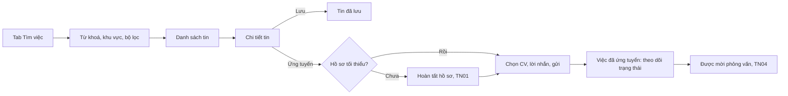

> **Mã:** DE05-TN02-PRD · **Trạng thái:** nháp · **Người viết:** Design (mock) · **SRS:** [SRS.md](SRS.md)

# PRD Tìm việc và ứng tuyển (App tìm việc)

> **Bản mock.** Con số đánh dấu `[giả định]` dùng để dựng flow, cần PO xác nhận trước khi dùng.

## 1. Bối cảnh và vấn đề

### 1.1 Bối cảnh

Ứng viên đã có hồ sơ ([TN01](../TN01-ho-so-cv/PRD.md)) và tin tuyển dụng đã được duyệt ([TN03](../TN03-dang-tin-kiem-duyet/PRD.md)). Tính năng này nối hai phía: ứng viên tìm được tin phù hợp, ứng tuyển bằng vài chạm, và luôn biết đơn của mình đang ở đâu.

### 1.2 Vấn đề

| **Vấn đề** | **Hệ quả** |
| --- | --- |
| Kết quả tìm kiếm nhiều tin không liên quan, tin trùng | Mất thời gian lọc, bỏ app |
| Tin không ghi lương, không ghi địa chỉ | Ứng tuyển rồi mới biết không phù hợp |
| Không phân biệt được tin thật, tin lừa đảo | Sợ ứng tuyển, hoặc bị lừa |
| Ứng tuyển xong không biết kết quả | Lo lắng, ứng tuyển tràn lan |
| Ứng tuyển nhầm, không rút lại được | Gửi CV sai cho công ty |

### 1.3 Mục tiêu

- ≥ 30% phiên tìm kiếm có ít nhất 1 lượt xem chi tiết tin `[giả định]`.
- Ứng tuyển trong ≤ 3 chạm từ màn chi tiết tin `[giả định]`.
- 100% đơn có trạng thái cập nhật cho ứng viên; ≥ 70% đơn được nhà tuyển dụng xem trong 7 ngày `[giả định]`.

## 2. Người dùng

| **Nhóm** | **Nhu cầu với tính năng này** |
| --- | --- |
| Sinh viên mới ra trường | Lọc việc không cần kinh nghiệm, thực tập |
| Người đi làm muốn đổi việc | Lọc theo lương, khu vực; lưu tin để xem sau |
| Lao động phổ thông | Tìm việc gần nhà, ứng tuyển không cần CV |

## 3. Phạm vi

### 3.1 Trong phạm vi (MVP)

- Tìm theo từ khoá và khu vực; gợi ý từ khoá.
- Bộ lọc: mức lương, kinh nghiệm, hình thức, ngành, ngày đăng.
- Danh sách tin: chức danh, công ty, lương, khu vực, nhãn "Đã xác minh".
- Chi tiết tin: mô tả, yêu cầu, quyền lợi, địa chỉ, thông tin công ty, báo cáo tin.
- Lưu tin, bỏ lưu.
- Ứng tuyển bằng hồ sơ, kèm CV (nếu tin yêu cầu) và lời nhắn.
- Danh sách đơn đã ứng tuyển và trạng thái; rút đơn.
- Gợi ý việc phù hợp theo mong muốn trong hồ sơ.

### 3.2 Ngoài phạm vi

- Thông báo việc mới theo bộ lọc đã lưu → phase sau.
- Bản đồ việc làm gần đây.
- Ứng tuyển nhanh hàng loạt.
- Đánh giá công ty.

## 4. Nguyên tắc sản phẩm

### 4.1 Thông tin quan trọng hiện trước

Danh sách luôn hiện mức lương, khu vực và hình thức. Chức danh, công ty không đủ để quyết định.

### 4.2 Tin cậy được nhìn thấy

Tin của công ty đã xác minh có nhãn rõ ràng. Mọi tin có nút báo cáo. Cảnh báo chung về việc không đóng phí khi ứng tuyển.

### 4.3 Ứng tuyển nhẹ nhàng

Hồ sơ đã có là đủ. CV và lời nhắn chỉ cần khi tin yêu cầu.

### 4.4 Không bỏ ứng viên trong im lặng

Mỗi đơn có trạng thái rõ ràng, được báo khi thay đổi. Đơn không được xử lý lâu thì nói thật với ứng viên.

## 5. Quy tắc nghiệp vụ

| **Quy tắc** | **Giá trị** `[giả định]` |
| --- | --- |
| Tin hiển thị | Chỉ tin đã duyệt, còn hạn, chưa đóng |
| Sắp xếp mặc định | Phù hợp nhất (khớp từ khoá, mong muốn), sau đó mới nhất |
| Lưu tin | Tối đa 100 tin |
| Ứng tuyển | Cần hồ sơ tối thiểu; mỗi tin ứng tuyển 1 lần |
| Lời nhắn | ≤ 500 ký tự |
| Rút đơn | Khi đơn chưa ở Mời phỏng vấn trở đi; rút xong không ứng tuyển lại tin đó trong 30 ngày |
| Đơn không được xử lý | Sau 14 ngày chưa được xem, ghi chú "Nhà tuyển dụng chưa phản hồi" |
| Giới hạn ứng tuyển | 20 đơn mỗi ngày |

- Các giá trị trên là **cấu hình**, không cố định trong code.

## 6. Luồng trải nghiệm

| **Bước** | **Giai đoạn** | **Trải nghiệm** | **Đầu ra** |
| --- | --- | --- | --- |
| 1 | Khám phá | Trang Tìm việc có ô tìm, gợi ý việc phù hợp | Danh sách tin |
| 2 | Thu hẹp | Bộ lọc lương, kinh nghiệm, hình thức, ngành, ngày đăng | Kết quả phù hợp |
| 3 | Xem chi tiết | Lương, địa chỉ, yêu cầu, công ty, nhãn xác minh | Quyết định ứng tuyển |
| 4 | Ứng tuyển | Xác nhận hồ sơ, chọn CV, lời nhắn; gửi | Đơn ứng tuyển |
| 5 | Theo dõi | Danh sách đơn, trạng thái, thông báo khi thay đổi | Biết kết quả |

## 7. Use Cases, User Stories và Acceptance Criteria

### UC1. Tìm việc

#### US1.1 Tìm theo từ khoá và khu vực

User Story: Là ứng viên, tôi muốn tìm việc theo chức danh và nơi làm để thấy tin phù hợp.

AC01: Ô tìm gợi ý chức danh khi gõ, chấp nhận không dấu.

AC02: Khu vực mặc định là khu vực làm việc mong muốn trong hồ sơ.

AC03: Kết quả hiện số tin tìm thấy; mỗi tin có chức danh, công ty, lương, khu vực, hình thức, ngày đăng, nhãn xác minh.

AC04: Không có kết quả → gợi ý bỏ bớt bộ lọc hoặc đổi từ khoá.

#### US1.2 Lọc kết quả

User Story: Là ứng viên, tôi muốn lọc kết quả theo lương, kinh nghiệm, hình thức để chỉ thấy tin phù hợp.

AC01: Lọc theo mức lương (khoảng), kinh nghiệm, hình thức, ngành, ngày đăng; có số kết quả trước khi áp dụng.

AC02: Bộ lọc đang dùng hiện thành chip, xoá từng chip được.

AC03: "Có ghi mức lương" là một bộ lọc riêng.

### UC2. Xem và lưu tin

#### US2.1 Xem chi tiết tin

User Story: Là ứng viên, tôi muốn xem đủ thông tin của tin và biết công ty đã xác minh để quyết định ứng tuyển an toàn.

AC01: Chi tiết tin gồm: chức danh, lương, khu vực và địa chỉ, hình thức, kinh nghiệm, hạn nộp, mô tả, yêu cầu, quyền lợi, thông tin công ty.

AC02: Nhãn "Công ty đã xác minh" khi công ty đã xác minh (TN03).

AC03: Cảnh báo ngắn: "Không đóng bất kỳ khoản phí nào khi ứng tuyển".

AC04: Nút báo cáo tin, chọn lý do (lừa đảo, sai thông tin, nội dung không phù hợp).

AC05: Đã ứng tuyển → nút Ứng tuyển thành "Đã ứng tuyển · Xem đơn".

#### US2.2 Lưu tin

User Story: Là ứng viên, tôi muốn lưu tin để xem sau, không mất tin hay.

AC01: Lưu, bỏ lưu từ danh sách và chi tiết; danh sách tin đã lưu trong tab Việc của tôi.

AC02: Tin đã lưu bị đóng hoặc hết hạn → vẫn hiện, nhãn "Đã đóng".

### UC3. Ứng tuyển

#### US3.1 Gửi đơn

User Story: Là ứng viên, tôi muốn ứng tuyển nhanh bằng hồ sơ có sẵn.

AC01: Chưa có hồ sơ tối thiểu → mời hoàn tất (TN01), xong quay lại đúng tin.

AC02: Màn ứng tuyển hiện tóm tắt hồ sơ, CV mặc định (đổi được), lời nhắn tuỳ chọn.

AC03: Tin yêu cầu CV mà chưa có CV → bắt buộc tải CV.

AC04: Gửi xong → báo thành công, nói rõ nhà tuyển dụng sẽ thấy số điện thoại, email.

AC05: Không gửi trùng khi bấm nhiều lần.

### UC4. Theo dõi đơn

#### US4.1 Xem trạng thái đơn

User Story: Là ứng viên, tôi muốn biết trạng thái từng đơn để không phải chờ trong mơ hồ.

AC01: Tab Việc của tôi → Đã ứng tuyển: chức danh, công ty, ngày gửi, trạng thái.

AC02: Trạng thái: Đã gửi, Đã xem, Mời phỏng vấn, Đã nhận, Chưa phù hợp, Đã rút, Tin đã đóng.

AC03: Có thông báo khi trạng thái đổi.

AC04: 14 ngày chưa được xem → ghi chú "Nhà tuyển dụng chưa phản hồi".

#### US4.2 Rút đơn

User Story: Là ứng viên, tôi muốn rút đơn khi không còn quan tâm để chủ động trong quá trình tìm việc.

AC01: Rút được khi đơn ở Đã gửi hoặc Đã xem; hỏi xác nhận.

AC02: Rút xong không ứng tuyển lại tin đó trong 30 ngày.

## 8. Chỉ số theo dõi `[giả định]`

| **Chỉ số** | **Định nghĩa** | **Mục tiêu MVP** |
| --- | --- | --- |
| Tỉ lệ xem chi tiết | Phiên tìm kiếm có xem chi tiết / phiên tìm kiếm | ≥ 30% |
| Tỉ lệ ứng tuyển | Lượt ứng tuyển / lượt xem chi tiết | ≥ 8% |
| Tỉ lệ tìm không ra | Lượt tìm 0 kết quả / lượt tìm | ≤ 10% |
| Tỉ lệ đơn được xem trong 7 ngày | Đơn chuyển Đã xem trong 7 ngày / đơn gửi | ≥ 70% |
| Tỉ lệ rút đơn | Đơn rút / đơn gửi | Theo dõi |
| Tỉ lệ báo cáo tin | Báo cáo / lượt xem chi tiết | Theo dõi |

## 9. Phụ thuộc và rủi ro

| **Mục** | **Mô tả** | **Hướng xử lý** |
| --- | --- | --- |
| Chất lượng tìm kiếm | Từ khoá tiếng Việt, đồng nghĩa ("kế toán", "accountant") | Từ điển đồng nghĩa; theo dõi tìm 0 kết quả |
| Tin lừa đảo lọt duyệt | Ứng viên bị lừa | Báo cáo tin, cảnh báo thường trực, xử lý ở TN03 |
| Ứng tuyển tràn lan | Nhà tuyển dụng ngập hồ sơ | Giới hạn 20 đơn mỗi ngày |
| Nhà tuyển dụng không phản hồi | Ứng viên mất niềm tin | Ghi chú 14 ngày; nhắc nhà tuyển dụng (TN04) |

## 10. Câu hỏi mở

- Có ẩn tin không ghi lương khỏi kết quả mặc định không?
- Tin hết hạn tự đóng đơn chưa xử lý thành "Tin đã đóng" hay giữ nguyên?
- Có cho ứng viên sửa lời nhắn sau khi gửi?
- Gợi ý việc phù hợp dựa trên mong muốn hay cả lịch sử xem tin?
