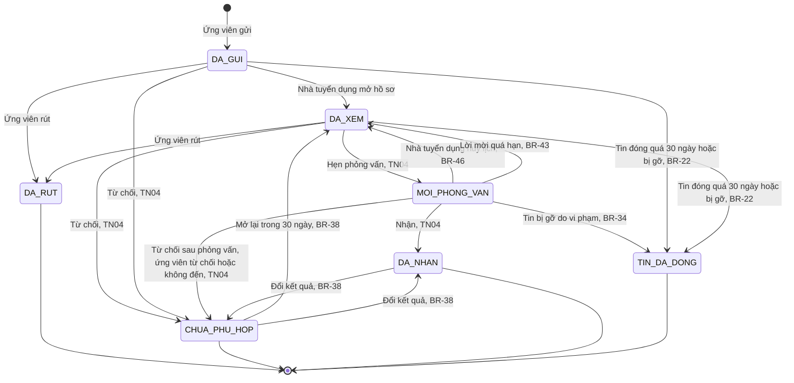
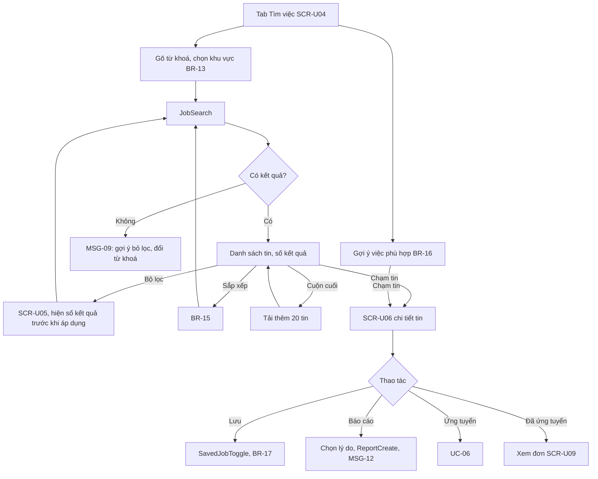
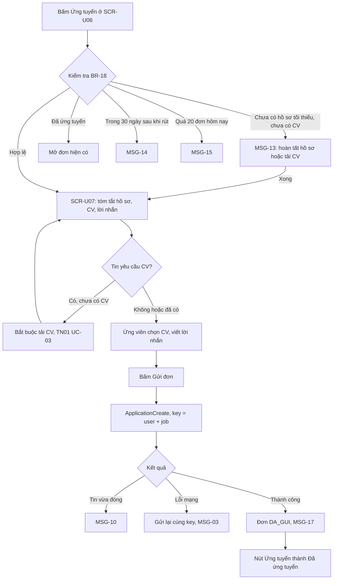
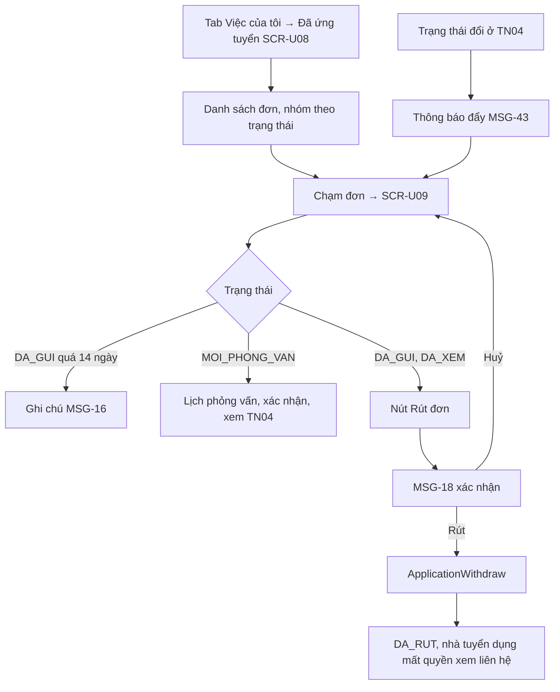
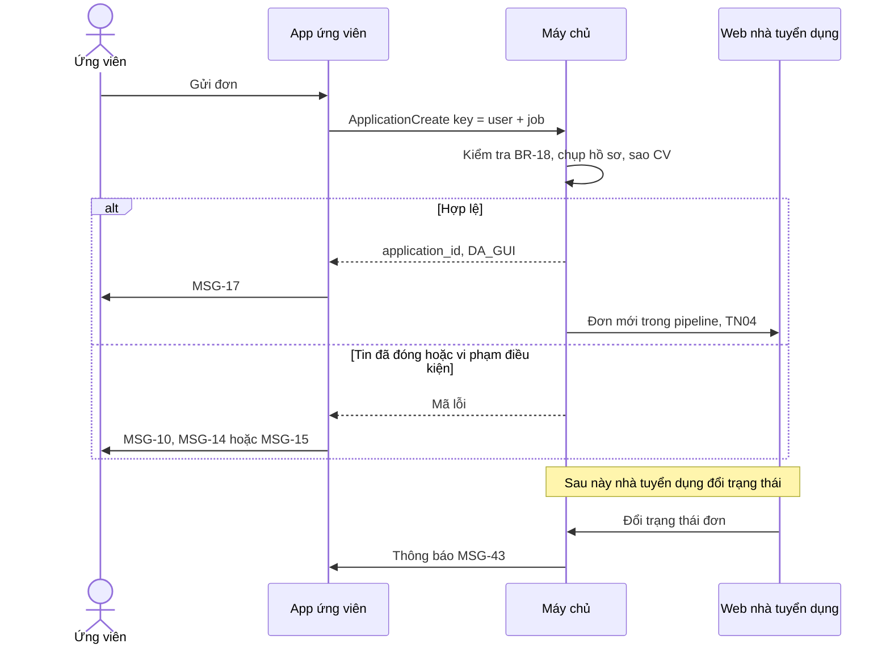

> **Mã:** DE05-TN02-SRS · **Trạng thái:** đã chốt · **Người viết:** Design · **PRD:** [PRD.md](PRD.md)

# UC-DE05-02 - Tìm việc và ứng tuyển

> Hồ sơ và CV xem [SRS TN01](../TN01-ho-so-cv/SRS.md); tin và kiểm duyệt xem [SRS TN03](../TN03-dang-tin-kiem-duyet/SRS.md); xử lý đơn phía nhà tuyển dụng xem [SRS TN04](../TN04-xu-ly-ho-so-phong-van/SRS.md).

## 1. Tổng quan

| **Mục** | **Nội dung** |
| --- | --- |
| Mục tiêu | Ứng viên tìm tin phù hợp, ứng tuyển bằng hồ sơ có sẵn, theo dõi và rút đơn |
| Actor | Ứng viên · App ứng viên · Máy chủ tìm kiếm · Nhà tuyển dụng (nhận đơn) |
| Phạm vi | Tìm kiếm, bộ lọc, gợi ý, chi tiết tin, lưu tin, báo cáo tin, ứng tuyển, danh sách đơn, rút đơn |
| Ngoài phạm vi | Thông báo việc mới theo bộ lọc, bản đồ việc, ứng tuyển hàng loạt, đánh giá công ty |
| Nền tảng | App ứng viên iOS / Android |

## 2. User Story

| **ID** | **As a** | **I want** | **So that** |
| --- | --- | --- | --- |
| US-06 | Ứng viên | Tìm việc theo từ khoá, khu vực, bộ lọc | Thấy tin phù hợp |
| US-07 | Ứng viên | Xem đủ thông tin tin, biết công ty đã xác minh | Quyết định ứng tuyển an toàn |
| US-08 | Ứng viên | Lưu tin để xem sau | Không mất tin hay |
| US-09 | Ứng viên | Ứng tuyển bằng vài chạm | Không phải điền lại |
| US-10 | Ứng viên | Biết trạng thái đơn và rút đơn khi cần | Chủ động trong quá trình tìm việc |
| US-11 | Ứng viên | Báo cáo tin đáng ngờ | Bảo vệ mình và người khác |

## 3. Business Rules

| **Mã** | **Quy tắc** |
| --- | --- |
| BR-11 | **Tin hiển thị**: trạng thái `DANG_HIEN` (SRS TN03), chưa hết hạn nộp; công ty không bị khoá. Tin của công ty ứng viên đã chặn vẫn hiện |
| BR-12 | **Tìm kiếm**: khớp chức danh, mô tả, kỹ năng, tên công ty; bỏ dấu, không phân biệt hoa thường; có từ điển đồng nghĩa. Gợi ý khi gõ ≥ 2 ký tự, chờ 300 ms |
| BR-13 | **Khu vực mặc định** = khu vực làm việc đầu tiên trong `MONG_MUON`; "Toàn quốc" khi chưa có |
| BR-14 | **Bộ lọc**: lương (khoảng, triệu/tháng), "Có ghi mức lương" (**bật sẵn mặc định**, nên tin "Thoả thuận" bị ẩn khỏi kết quả mặc định; người dùng tắt để xem cả tin này), kinh nghiệm (Chưa có, Dưới 1 năm, 1–3, 3–5, Trên 5), hình thức, ngành, ngày đăng (24 giờ, 7 ngày, 30 ngày). Trong một nhóm là HOẶC, giữa các nhóm là VÀ |
| BR-15 | **Sắp xếp**: Phù hợp nhất (mặc định), Mới nhất, Lương cao nhất. Tin "Lương thoả thuận" xếp cuối khi sắp theo lương |
| BR-16 | **Gợi ý việc phù hợp**: tin khớp vị trí hoặc ngành, và khu vực trong `MONG_MUON` của hồ sơ mặc định (TN01 BR-48); tối đa 20, mới nhất trước |
| BR-17 | **Lưu tin** tối đa 100; vượt → MSG-11. Tin đã lưu đổi trạng thái vẫn giữ trong danh sách với nhãn tương ứng |
| BR-18 | **Điều kiện ứng tuyển**: hồ sơ `TOI_THIEU` trở lên, hoặc ứng tuyển bằng CV (họ tên, số điện thoại đã xác minh và 1 CV `SAN_SANG`, TN01 BR-04); chưa có đơn còn hiệu lực cho tin này (đơn `DA_RUT` và `TIN_DA_DONG` không tính là còn hiệu lực); không trong 30 ngày sau khi rút đơn tin này; chưa quá 20 đơn trong ngày; tin `DANG_HIEN`. Tin yêu cầu CV → bắt buộc CV `SAN_SANG` |
| BR-19 | **Nội dung đơn**: bản chụp hồ sơ tại thời điểm gửi, CV đã chọn (bản sao), lời nhắn ≤ 500 ký tự. Sửa hồ sơ sau khi gửi không đổi đơn đã gửi |
| BR-20 | **Gửi đơn** dùng idempotency key = user_id + job_id + số thứ tự lần ứng tuyển (bằng số đơn cũ của ứng viên cho tin này + 1); bấm nhiều lần chỉ tạo 1 đơn, còn lần ứng tuyển lại hợp lệ theo BR-18 tạo đơn mới. Đơn cũ `DA_RUT`, `TIN_DA_DONG` vẫn giữ trong lịch sử. Gửi xong, nhà tuyển dụng thấy liên hệ của ứng viên (BR-09) |
| BR-21 | **Rút đơn** khi đơn `DA_GUI` hoặc `DA_XEM`; đơn chuyển `DA_RUT`, nhà tuyển dụng thấy nhãn "Ứng viên đã rút" và mất quyền xem liên hệ |
| BR-22 | **Đơn chậm**: 14 ngày ở `DA_GUI` → hiện ghi chú MSG-16 (không đổi trạng thái). **Tin đóng** (`DA_DONG`, do nhà tuyển dụng đóng hoặc hết hạn): đơn `DA_GUI`, `DA_XEM`, `MOI_PHONG_VAN` giữ nguyên trạng thái, nhà tuyển dụng vẫn xử lý được, ứng viên thấy thêm ghi chú "Tin đã ngừng nhận hồ sơ"; tin mở lại trong 30 ngày thì đơn không đổi. Hết 30 ngày tin chưa mở lại → đơn còn `DA_GUI`, `DA_XEM` chuyển `TIN_DA_DONG`; đơn `MOI_PHONG_VAN` giữ nguyên tới khi có kết quả. Tin bị gỡ → theo BR-34. Tin mở lại sau 30 ngày (duyệt lại) không khôi phục đơn `TIN_DA_DONG`; ứng viên ứng tuyển lại được (BR-18) |

## 4. Trạng thái

### 4.1 Trạng thái đơn ứng tuyển (dùng chung TN02, TN04)

| **Trạng thái** | **Ứng viên thấy** | **Rút được** |
| --- | --- | --- |
| `DA_GUI` | "Đã gửi {ngày}"; sau 14 ngày thêm MSG-16 | Có |
| `DA_XEM` | "Nhà tuyển dụng đã xem hồ sơ" | Có |
| `MOI_PHONG_VAN` | "Được mời phỏng vấn" + lịch (SRS TN04) | Không; xin đổi hoặc từ chối lịch theo SRS TN04, BR-43 |
| `DA_NHAN` | "Chúc mừng! Bạn đã được nhận" | Không |
| `CHUA_PHU_HOP` | "Chưa phù hợp lần này" + lời nhắn của nhà tuyển dụng nếu có | Không |
| `DA_RUT` | "Bạn đã rút đơn" | – |
| `TIN_DA_DONG` | "Tin đã đóng"; tin mở lại thì ứng tuyển lại được | – |

## 5. Use Case

### UC-05 Tìm và xem tin

| **Mục** | **Nội dung** |
| --- | --- |
| Tiền điều kiện | Không có (tìm được khi chưa đăng nhập; ứng tuyển cần đăng nhập) |
| Hậu điều kiện | Ứng viên xem được chi tiết tin phù hợp |

**Luồng chính**

| **Bước** | **Actor** | **Mô tả** |
| --- | --- | --- |
| 1 | Ứng viên | Mở tab Tìm việc |
| 2 | App | **SCR-U04** với gợi ý việc phù hợp và ô tìm; khu vực mặc định theo BR-13 |
| 3 | Ứng viên | Gõ từ khoá hoặc chọn gợi ý |
| 4 | App | Gọi \[JobSearch\] theo BR-12, BR-14, BR-15; hiện danh sách |
| 5 | Ứng viên | Chạm một tin |
| 6 | App | Mở **SCR-U06** (\[JobGet\]) |

**Luồng thay thế**

| **Mã** | **Điều kiện** | **Xử lý** |
| --- | --- | --- |
| A1 | Không có kết quả | MSG-09 với các chip bộ lọc đang dùng để xoá nhanh |
| A2 | Mở **SCR-U05** | Chọn bộ lọc; nút "Xem {n} việc" cập nhật số kết quả |
| A3 | Tin vừa bị đóng hoặc gỡ khi đang xem | **SCR-U06** hiện MSG-10, ẩn nút Ứng tuyển |
| A4 | Lưu tin khi chưa đăng nhập | Mời đăng nhập, xong quay lại và lưu |
| A5 | Đủ 100 tin đã lưu | MSG-11 |

### UC-06 Ứng tuyển

| **Mục** | **Nội dung** |
| --- | --- |
| Tiền điều kiện | Ứng viên đã đăng nhập; tin `DANG_HIEN` |
| Hậu điều kiện thành công | Đơn `DA_GUI`; nhà tuyển dụng nhận đơn mới (SRS TN04) |
| Hậu điều kiện thất bại | Không tạo đơn |

**Luồng chính**

| **Bước** | **Actor** | **Mô tả** |
| --- | --- | --- |
| 1 | Ứng viên | Bấm "Ứng tuyển" ở **SCR-U06** |
| 2 | App | Kiểm tra BR-18; hợp lệ → mở **SCR-U07** |
| 3 | Ứng viên | Xem tóm tắt hồ sơ; chọn CV (mặc định đã chọn sẵn); viết lời nhắn (tuỳ chọn) |
| 4 | Ứng viên | Bấm "Gửi đơn" |
| 5 | App | Gọi \[ApplicationCreate\] theo BR-19, BR-20 |
| 6 | App | Hiện MSG-17; nút trên **SCR-U06** đổi thành "Đã ứng tuyển · Xem đơn" |

**Luồng thay thế**

| **Mã** | **Điều kiện** | **Xử lý** |
| --- | --- | --- |
| A1 | Chưa có hồ sơ tối thiểu | Đã có CV `SAN_SANG` → ứng tuyển bằng CV, **SCR-U07** chỉ hỏi họ tên nếu chưa có. Chưa có CV → MSG-13: chọn "Hoàn tất hồ sơ" (onboarding) hoặc "Ứng tuyển bằng CV" (tải CV ở **SCR-U03**) → quay lại bước 2 |
| A2 | Tin yêu cầu CV, chưa có CV | Mở tải CV; xong quay lại bước 3 |
| A3 | Đổi CV | Chọn trong danh sách CV `SAN_SANG` |
| A4 | Xem hồ sơ như nhà tuyển dụng thấy | Mở xem trước (SRS TN01) |

**Luồng lỗi**

| **Mã** | **Điều kiện** | **Xử lý** |
| --- | --- | --- |
| E1 | Tin đóng trong lúc ứng tuyển | MSG-10, không tạo đơn |
| E2 | Lỗi mạng | Gửi lại cùng idempotency key; vẫn lỗi → MSG-03 |

### UC-07 Theo dõi và rút đơn

| **Mục** | **Nội dung** |
| --- | --- |
| Tiền điều kiện | Có ít nhất 1 đơn |
| Hậu điều kiện | Ứng viên biết trạng thái đơn; đơn `DA_RUT` nếu rút |

**Luồng chính**

| **Bước** | **Actor** | **Mô tả** |
| --- | --- | --- |
| 1 | Ứng viên | Tab Việc của tôi → Đã ứng tuyển (**SCR-U08**) |
| 2 | Hệ thống | Hiện danh sách đơn, nhóm theo trạng thái |
| 3 | Ứng viên | Chạm một đơn → **SCR-U09** |
| 4 | Ứng viên | Đơn `DA_GUI` hoặc `DA_XEM`: bấm Rút đơn |
| 5 | Hệ thống | MSG-18 hỏi xác nhận |
| 6 | Ứng viên | Chọn Rút |
| 7 | Hệ thống | Gọi \[ApplicationWithdraw\]; đơn `DA_RUT`, nhà tuyển dụng mất quyền xem liên hệ |

**Luồng thay thế**

| **Mã** | **Điều kiện** | **Xử lý** |
| --- | --- | --- |
| A1 | Đơn `DA_GUI` quá 14 ngày | Hiện ghi chú MSG-16 |
| A2 | Đơn `MOI_PHONG_VAN` | Hiện lịch phỏng vấn và các nút trả lời (SRS TN04); không có nút Rút đơn |
| A3 | Chọn Huỷ ở MSG-18 | Ở lại **SCR-U09**, đơn không đổi |
| A4 | Trạng thái đơn đổi (SRS TN04) | Thông báo đẩy MSG-43; chạm mở **SCR-U09** |

**Luồng lỗi**

| **Mã** | **Điều kiện** | **Xử lý** |
| --- | --- | --- |
| E1 | Rút đơn thất bại (mất mạng, đơn vừa đổi trạng thái) | Báo lỗi, tải lại trạng thái đơn mới nhất |

## 6. Điểm vào

| **Điểm vào** | **Nền tảng** | **Dẫn tới** | **Ghi chú** |
| --- | --- | --- | --- |
| Tab Tìm việc | App ứng viên | UC-05, **SCR-U04** |  |
| Link chia sẻ tin | App ứng viên · Web | **SCR-U06** | Mở app hoặc trang Web tin |
| Tab Việc của tôi → Đã lưu | App ứng viên | Danh sách tin đã lưu |  |
| Tab Việc của tôi → Đã ứng tuyển | App ứng viên | UC-07, **SCR-U08** |  |
| Thông báo trạng thái đơn | App ứng viên | **SCR-U09** |  |

## 7. Mô tả màn hình

### SCR-U04 Tìm việc

| **#** | **Thành phần** | **Loại** | **Hành vi** |
| --- | --- | --- | --- |
| 1 | Ô từ khoá | Search | Gợi ý chức danh (BR-12) |
| 2 | Khu vực | Dòng chọn | BR-13; chọn tỉnh, quận |
| 3 | Bộ lọc | Button + badge | Số bộ lọc đang dùng; mở **SCR-U05** |
| 4 | Chip bộ lọc | Chips | Bộ lọc đang dùng, ✕ để xoá |
| 5 | Sắp xếp | Menu | BR-15 |
| 6 | Thẻ tin | List item | Chức danh, logo, tên công ty, nhãn xác minh, lương (hoặc "Thoả thuận"), khu vực, hình thức, "{n} ngày trước", nút lưu |
| 7 | Gợi ý cho bạn | Section | BR-16; chỉ khi chưa nhập từ khoá |
| 8 | Màn trống | Empty state | MSG-09 |

### SCR-U05 Bộ lọc (bottom sheet toàn màn)

| **#** | **Thành phần** | **Loại** | **Hành vi** |
| --- | --- | --- | --- |
| 1 | Mức lương | Thanh kéo hai đầu | Khoảng triệu/tháng (BR-14) |
| 2 | Có ghi mức lương | Toggle | Bật → chỉ hiện tin có ghi lương |
| 3 | Kinh nghiệm | Chips chọn nhiều | Chưa có, Dưới 1 năm, 1–3, 3–5, Trên 5 |
| 4 | Hình thức | Chips chọn nhiều | Theo hình thức làm việc của tin |
| 5 | Ngành | Danh sách chọn nhiều, có ô tìm | Hiện số ngành đã chọn |
| 6 | Ngày đăng | Chips chọn một | 24 giờ, 7 ngày, 30 ngày |
| 7 | Xoá tất cả | Button text | Bỏ mọi lựa chọn, chỉ bật khi có bộ lọc đang dùng |
| 8 | "Xem {n} việc" | Button | Số kết quả cập nhật sau mỗi lựa chọn; n = 0 → "Không có việc phù hợp", vẫn bấm được để về **SCR-U04** với MSG-09 |

Đóng **SCR-U05** bằng vuốt xuống hoặc ✕ thì không áp dụng thay đổi. Trong một nhóm là HOẶC, giữa các nhóm là VÀ (BR-14).

### SCR-U06 Chi tiết tin

| **#** | **Thành phần** | **Loại** | **Hành vi** |
| --- | --- | --- | --- |
| 1 | Đầu tin | Header | Chức danh, công ty, nhãn xác minh, lương, khu vực, hình thức, kinh nghiệm, hạn nộp |
| 2 | Cảnh báo an toàn | Banner nhỏ | "Không đóng bất kỳ khoản phí nào khi ứng tuyển" |
| 3 | Nội dung | Sections | Mô tả, Yêu cầu, Quyền lợi, Địa chỉ làm việc |
| 4 | Công ty | Card | Logo, tên, quy mô, ngành, tóm tắt; số tin đang tuyển |
| 5 | Lưu, Chia sẻ, Báo cáo | Icons | Báo cáo mở chọn lý do |
| 6 | Nút chính | Button cố định | "Ứng tuyển" / "Đã ứng tuyển · Xem đơn" / "Tin đã đóng" (disabled) |

### SCR-U07 Ứng tuyển

| **#** | **Thành phần** | **Loại** | **Bắt buộc** | **Validate / hành vi** |
| --- | --- | --- | --- | --- |
| 1 | Tin | Header | – | Chức danh, công ty |
| 2 | Hồ sơ | Card / chọn 1 | – | Có nhiều hồ sơ → chọn hồ sơ gửi, mặc định là hồ sơ mặc định (TN01 BR-48); tóm tắt; "Xem như nhà tuyển dụng". Ứng tuyển bằng CV → thay bằng họ tên, số điện thoại |
| 3 | CV | Chọn 1 | Khi tin yêu cầu, hoặc khi ứng tuyển bằng CV | CV `SAN_SANG`; "Tải CV mới" |
| 4 | Lời nhắn | Text | Không | ≤ 500 ký tự, bộ đếm |
| 5 | Ghi chú liên hệ | Text phụ | – | "Nhà tuyển dụng sẽ thấy số điện thoại và email của bạn" |
| 6 | Gửi đơn | Button | – | Disabled khi thiếu CV bắt buộc; loading khi gửi |

### SCR-U08 Việc đã ứng tuyển

| **#** | **Thành phần** | **Loại** | **Hành vi** |
| --- | --- | --- | --- |
| 1 | Lọc trạng thái | Chips | Tất cả, Đang chờ (Đã gửi, Đã xem), Phỏng vấn, Kết quả |
| 2 | Thẻ đơn | List item | Chức danh, công ty, ngày gửi, nhãn trạng thái (chữ + biểu tượng), ghi chú MSG-16 nếu có |
| 3 | Màn trống | Empty state | "Bạn chưa ứng tuyển việc nào. \[Tìm việc\]" |

## 8. API

| **API** | **Request chính** | **Response chính** | **Timeout / retry** |
| --- | --- | --- | --- |
| \[JobSuggest\] | keyword | Chức danh gợi ý | 2s / không retry |
| \[JobSearch\] | keyword, location, filters, sort, cursor | Tin, total, cursor | 3s / 1 lần |
| \[JobRecommend\] | user_id | Tối đa 20 tin | 3s / 1 lần |
| \[JobGet\] | job_id | Chi tiết tin, công ty, applied (bool), application_id | 3s / 1 lần |
| \[SavedJobToggle\] | job_id, saved | – | 3s / 2 lần |
| \[ReportCreate\] | job_id, reason, note | report_id | 5s / 2 lần |
| \[ApplicationCreate\] | job_id, profile_id (rỗng khi ứng tuyển bằng CV), cv_id, message, idempotency_key | application_id, status `DA_GUI` | 8s / gửi lại cùng key |
| \[ApplicationList\] | user_id, status, cursor | Đơn | 3s / 1 lần |
| \[ApplicationWithdraw\] | application_id | status `DA_RUT` | 5s / 2 lần |

**Map lỗi → thông báo**

| **Nhóm lỗi** | **Message** |
| --- | --- |
| Tin đã đóng khi mở hoặc khi gửi đơn | MSG-10 |
| Vượt giới hạn tin đã lưu | MSG-11 |
| Hồ sơ chưa đủ để ứng tuyển | MSG-13 |
| Đã rút đơn, chưa đủ 30 ngày | MSG-14 |
| Vượt giới hạn ứng tuyển trong ngày | MSG-15 |
| Mất mạng, lỗi máy chủ | Thông báo lỗi chung của app (ngoài bộ MSG của SRS này), cho thử lại |

## 9. Danh sách thông báo

| **ID** | **Nơi hiện** | **Nội dung (VI)** |
| --- | --- | --- |
| MSG-09 | **SCR-U04** | Chưa tìm thấy việc phù hợp. Thử bỏ bớt bộ lọc hoặc dùng từ khoá khác |
| MSG-10 | Banner **SCR-U06** | Tin này đã đóng nhận hồ sơ |
| MSG-11 | Toast | Bạn đã lưu 100 tin. Bỏ lưu bớt để lưu tin mới |
| MSG-12 | Toast | Cảm ơn bạn đã báo cáo. Chúng tôi sẽ kiểm tra tin này |
| MSG-13 | Popup | Để ứng tuyển, hãy hoàn tất hồ sơ (khoảng 3 phút) hoặc tải lên CV có sẵn. \[Hoàn tất hồ sơ\] \[Ứng tuyển bằng CV\] |
| MSG-14 | Popup | Bạn đã rút đơn tin này. Bạn có thể ứng tuyển lại từ ngày {dd/mm/yyyy} |
| MSG-15 | Popup | Bạn đã ứng tuyển 20 việc hôm nay. Hãy quay lại vào ngày mai nhé |
| MSG-16 | Ghi chú đơn | Nhà tuyển dụng chưa phản hồi sau 14 ngày. Bạn có thể tiếp tục ứng tuyển các việc khác |
| MSG-17 | Màn thành công | Đã gửi đơn tới {công ty}. Bạn sẽ nhận thông báo khi có cập nhật. \[Xem đơn\] \[Tìm việc khác\] |
| MSG-18 | Popup | Rút đơn ứng tuyển {chức danh}? Bạn không thể ứng tuyển lại tin này trong 30 ngày. \[Giữ đơn\] \[Rút đơn\] |
| MSG-43 | Thông báo đẩy | {Công ty}: đơn {chức danh} của bạn đã chuyển sang "{trạng thái}" |

## 10. Yêu cầu phi chức năng

| **Mục** | **Yêu cầu** |
| --- | --- |
| Hiệu năng | Kết quả tìm kiếm ≤ 1,5 giây (p95); **SCR-U06** ≤ 1 giây |
| Tính nhất quán | Tin bị gỡ, đóng biến mất khỏi kết quả tìm kiếm ≤ 1 phút |
| Bảo mật | Liên hệ ứng viên chỉ trả về cho nhà tuyển dụng có đơn hợp lệ (không `DA_RUT`) |
| Chống lạm dụng | Giới hạn 20 đơn mỗi ngày; giới hạn tốc độ tìm kiếm theo thiết bị |
| Log / audit | Mỗi đơn: thời điểm gửi, CV đã dùng, từng lần đổi trạng thái; mỗi báo cáo tin: người báo, lý do, thời điểm |
| Tracking | Tìm (từ khoá, bộ lọc, số kết quả), xem tin, lưu, báo cáo, bắt đầu và gửi đơn, rút đơn, mở thông báo |
| Accessibility | Nhãn trạng thái có chữ và biểu tượng; thẻ tin đọc đủ chức danh, công ty, lương, khu vực; bộ lọc thao tác được bằng trình đọc màn hình |
