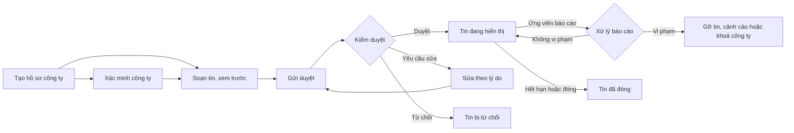

> **Mã:** DE05-TN03-PRD · **Trạng thái:** nháp · **Người viết:** Design (mock) · **SRS:** [SRS.md](SRS.md)

# PRD Đăng tin tuyển dụng và kiểm duyệt (App tìm việc)

> **Bản mock.** Con số đánh dấu `[giả định]` dùng để dựng flow, cần PO xác nhận trước khi dùng.

## 1. Bối cảnh và vấn đề

### 1.1 Bối cảnh

Tin tuyển dụng là nguồn cung của sàn. Một tin lừa đảo đủ làm ứng viên mất tiền và mất niềm tin vào cả sàn. Tính năng này phục vụ hai vai trò: nhà tuyển dụng xác minh công ty và đăng tin nhanh; đội kiểm duyệt duyệt tin trước khi hiển thị và xử lý báo cáo vi phạm.

### 1.2 Vấn đề

| **Vấn đề** | **Hệ quả** |
| --- | --- |
| Tin lừa đảo: thu phí, việc nhẹ lương cao, tuyển cộng tác viên online | Ứng viên bị lừa; sàn mất uy tín |
| Tin thiếu lương, địa chỉ, mô tả chung chung | Ứng viên không quyết định được, ứng tuyển tràn lan |
| Duyệt thủ công chậm | Nhà tuyển dụng chờ lâu, bỏ sang sàn khác |
| Từ chối không nêu lý do | Nhà tuyển dụng không biết sửa gì |
| Báo cáo của ứng viên không được xử lý | Tin xấu vẫn hiện, ứng viên không báo nữa |

### 1.3 Mục tiêu

- ≥ 90% tin được duyệt hoặc từ chối trong 4 giờ làm việc `[giả định]`.
- Tỉ lệ tin bị gỡ sau khi đã hiển thị (do vi phạm) ≤ 1% `[giả định]`.
- 100% báo cáo vi phạm được xử lý trong 24 giờ `[giả định]`.

## 2. Người dùng

| **Nhóm** | **Nhu cầu với tính năng này** |
| --- | --- |
| Nhà tuyển dụng doanh nghiệp nhỏ | Đăng tin nhanh, dùng lại tin cũ, biết vì sao bị từ chối |
| Nhân sự công ty lớn | Nhiều tin cùng lúc, đóng, mở lại tin |
| Kiểm duyệt viên | Hàng đợi rõ ràng, công cụ phát hiện dấu hiệu lừa đảo, mẫu lý do từ chối |

## 3. Phạm vi

### 3.1 Trong phạm vi (MVP)

- Hồ sơ công ty; xác minh bằng giấy phép kinh doanh và email tên miền công ty.
- Soạn tin theo mẫu có trường bắt buộc; xem trước như ứng viên thấy; lưu nháp.
- Gửi duyệt; trạng thái tin; sửa và gửi lại khi bị từ chối.
- Đóng tin, mở lại tin, nhân bản tin.
- Kiểm duyệt: hàng đợi, kiểm tra tự động (từ khoá cấm, mức lương bất thường), duyệt, từ chối kèm lý do, yêu cầu sửa.
- Báo cáo vi phạm từ ứng viên; gỡ tin; khoá công ty.

### 3.2 Ngoài phạm vi

- Gói đăng tin trả phí, tin nổi bật.
- Nhiều tài khoản nhân sự trong một công ty, phân quyền → phase sau.
- Duyệt tự động hoàn toàn bằng AI.
- Đăng tin hàng loạt bằng file.

## 4. Nguyên tắc sản phẩm

### 4.1 Không có tin nào hiện mà chưa qua duyệt

Mọi tin mới và mọi lần sửa nội dung quan trọng đều qua duyệt trước khi ứng viên thấy.

### 4.2 Bắt buộc những gì ứng viên cần

Mức lương (hoặc khoảng), địa chỉ làm việc và mô tả công việc là bắt buộc. Tin đầy đủ được duyệt nhanh hơn.

### 4.3 Từ chối phải chỉ cách sửa

Mỗi lần từ chối có lý do cụ thể, chỉ rõ trường cần sửa.

### 4.4 Báo cáo được lắng nghe

Báo cáo của ứng viên vào hàng đợi ưu tiên; nhiều báo cáo thì tạm ẩn tin ngay trong khi chờ xử lý.

## 5. Quy tắc nghiệp vụ

| **Quy tắc** | **Giá trị** `[giả định]` |
| --- | --- |
| Xác minh công ty | Giấy phép kinh doanh (ảnh, mã số thuế) hoặc email tên miền công ty |
| Công ty chưa xác minh | Được đăng tối đa 2 tin đang hiển thị; tin không có nhãn xác minh |
| Trường bắt buộc | Chức danh, ngành, hình thức, số lượng, lương (khoảng, hoặc "Thoả thuận" kèm lý do), địa chỉ, mô tả ≥ 100 ký tự, yêu cầu, hạn nộp |
| Hạn nộp | Nhà tuyển dụng chọn số ngày nhận hồ sơ, 7 đến 60 ngày; hạn nộp chính thức = ngày duyệt + số ngày đó |
| Thời gian duyệt mục tiêu | 4 giờ làm việc |
| Sửa tin đang hiện | Sửa lương, chức danh, mô tả → duyệt lại; sửa hạn nộp, số lượng → không cần |
| Báo cáo | ≥ 3 báo cáo trong 24 giờ → tự tạm ẩn tin |
| Từ chối 3 lần | Tin bị khoá, cần liên hệ hỗ trợ |

- Các giá trị trên là **cấu hình**, không cố định trong code.

## 6. Luồng trải nghiệm

| **Bước** | **Vai trò** | **Trải nghiệm** | **Đầu ra** |
| --- | --- | --- | --- |
| 1 | Nhà tuyển dụng | Tạo hồ sơ công ty; gửi xác minh | Công ty chờ xác minh |
| 2 | Nhà tuyển dụng | Soạn tin theo mẫu, xem trước | Tin nháp |
| 3 | Nhà tuyển dụng | Gửi duyệt; thấy thời gian duyệt dự kiến | Tin chờ duyệt |
| 4 | Kiểm duyệt viên | Mở tin trong hàng đợi, xem cảnh báo tự động, quyết định | Duyệt, yêu cầu sửa, từ chối |
| 5 | Nhà tuyển dụng | Nhận kết quả; sửa và gửi lại nếu cần | Tin đang hiển thị |
| 6 | Kiểm duyệt viên | Xử lý báo cáo từ ứng viên | Giữ tin hoặc gỡ tin |

## 7. Use Cases, User Stories và Acceptance Criteria

### UC1. Hồ sơ và xác minh công ty

#### US1.1 Xác minh công ty

User Story: Là nhà tuyển dụng, tôi muốn xác minh công ty để tin của tôi được tin tưởng và hiện nhãn xác minh.

AC01: Hồ sơ công ty: tên, mã số thuế, địa chỉ, quy mô, ngành, logo, giới thiệu.

AC02: Xác minh bằng ảnh giấy phép kinh doanh hoặc xác nhận email tên miền công ty.

AC03: Trạng thái xác minh hiện rõ: Chưa xác minh, Đang xét, Đã xác minh, Bị từ chối (kèm lý do).

AC04: Chưa xác minh → đăng tối đa 2 tin hiển thị; báo rõ giới hạn.

### UC2. Đăng tin

#### US2.1 Soạn và gửi tin

User Story: Là nhà tuyển dụng, tôi muốn đăng tin nhanh và được duyệt ngay lần đầu.

AC01: Form theo nhóm: Thông tin chung, Lương và quyền lợi, Mô tả và yêu cầu, Địa điểm, Hạn nộp.

AC02: Trường bắt buộc có dấu và lỗi inline; tự lưu nháp.

AC03: Xem trước tin như ứng viên thấy trên điện thoại.

AC04: Gửi duyệt → hiện thời gian duyệt dự kiến.

AC05: Nhân bản tin cũ để đăng nhanh.

#### US2.2 Theo dõi và quản lý tin

User Story: Là nhà tuyển dụng, tôi muốn theo dõi trạng thái tin và đóng, mở lại tin để quản lý tin dễ dàng.

AC01: Danh sách tin theo trạng thái: Nháp, Chờ duyệt, Cần sửa, Đang hiển thị, Bị từ chối, Đã đóng, Bị gỡ.

AC02: Yêu cầu sửa, từ chối → hiện lý do và trường cần sửa; bấm "Sửa" mở đúng trường.

AC03: Đóng tin chủ động; mở lại tin đã đóng (cần duyệt lại nếu đóng quá 30 ngày).

AC04: Thông báo email và trên Web khi trạng thái tin thay đổi.

### UC3. Kiểm duyệt

#### US3.1 Duyệt tin

User Story: Là kiểm duyệt viên, tôi muốn duyệt nhanh và chính xác, phát hiện được tin đáng ngờ.

AC01: Hàng đợi sắp theo thời gian chờ; tin có cảnh báo tự động được ưu tiên.

AC02: Màn duyệt hiện tin, hồ sơ công ty, trạng thái xác minh, lịch sử vi phạm, cảnh báo tự động (từ khoá cấm, lương bất thường, liên hệ ngoài sàn).

AC03: Ba quyết định: Duyệt, Yêu cầu sửa (chọn trường và lý do mẫu), Từ chối (chọn lý do mẫu).

AC04: Một tin chỉ một kiểm duyệt viên mở tại một thời điểm.

#### US3.2 Xử lý báo cáo

User Story: Là kiểm duyệt viên, tôi muốn xử lý báo cáo vi phạm để gỡ tin lừa đảo kịp thời.

AC01: Báo cáo vào hàng đợi riêng, ưu tiên cao.

AC02: ≥ 3 báo cáo trong 24 giờ → tin tự tạm ẩn.

AC03: Quyết định: Giữ tin, Gỡ tin, Gỡ tin và khoá công ty; nhà tuyển dụng được báo lý do.

AC04: Ứng viên đã báo cáo nhận kết quả xử lý.

## 8. Chỉ số theo dõi `[giả định]`

| **Chỉ số** | **Định nghĩa** | **Mục tiêu MVP** |
| --- | --- | --- |
| Thời gian duyệt | Từ gửi duyệt tới quyết định | ≤ 4 giờ làm việc ở ≥ 90% tin |
| Tỉ lệ duyệt lần đầu | Tin duyệt ngay lần gửi đầu / tin gửi | ≥ 70% |
| Tỉ lệ công ty xác minh | Công ty đã xác minh / công ty có tin | ≥ 60% |
| Tỉ lệ gỡ sau hiển thị | Tin bị gỡ / tin đã duyệt | ≤ 1% |
| Thời gian xử lý báo cáo | Từ báo cáo tới quyết định | ≤ 24 giờ |
| Tỉ lệ tin có lương | Tin có khoảng lương / tin đang hiển thị | ≥ 80% |

## 9. Phụ thuộc và rủi ro

| **Mục** | **Mô tả** | **Hướng xử lý** |
| --- | --- | --- |
| Năng lực đội kiểm duyệt | Tin dồn giờ cao điểm | Kiểm tra tự động xếp ưu tiên; theo dõi hàng đợi |
| Giấy phép giả | Ảnh chỉnh sửa | Kiểm duyệt viên xét ảnh giấy phép (SRS BR-24); không đối chiếu tự động với cơ sở dữ liệu bên ngoài |
| Kẻ gian lách từ khoá | Viết lách để qua lọc | Cập nhật danh sách từ khoá; báo cáo của ứng viên |
| Duyệt sai, chặn nhầm | Nhà tuyển dụng thật bị từ chối | Lý do cụ thể, sửa và gửi lại; kênh khiếu nại |

## 10. Câu hỏi mở

> Câu nào đã có giá trị ở mục 5 thì giá trị đó là **tạm chốt** `[giả định]` để dựng flow. Câu hỏi vẫn để mở cho đến khi PO xác nhận.

- Công ty chưa xác minh có được đăng tin không, hay bắt buộc xác minh trước?
- Có cho "Lương thoả thuận" không, hay bắt buộc khoảng lương?
- Ngưỡng 3 báo cáo để tạm ẩn có phù hợp?
- Kiểm duyệt có làm 24/7 không? → **Đã chốt:** Không. Chỉ cần có kiểm duyệt viên trong giờ hành chính; tin gửi ngoài giờ nằm trong hàng đợi.
