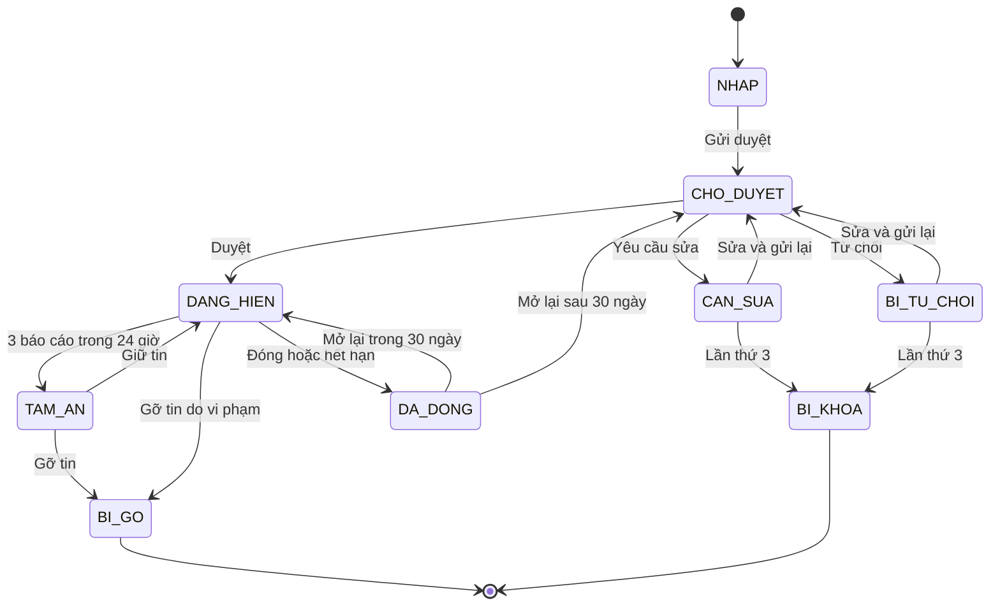
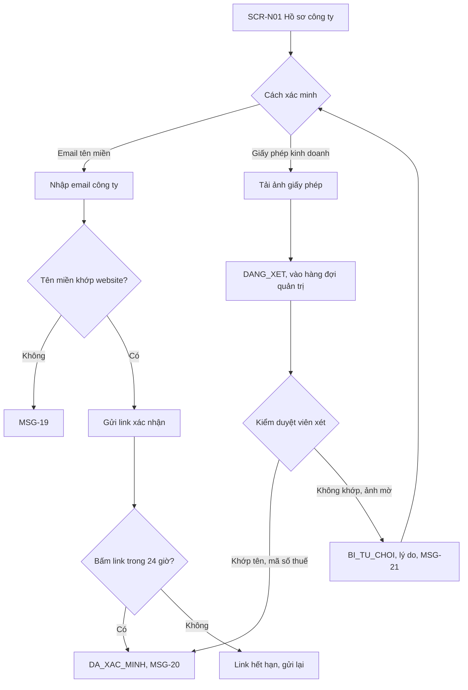
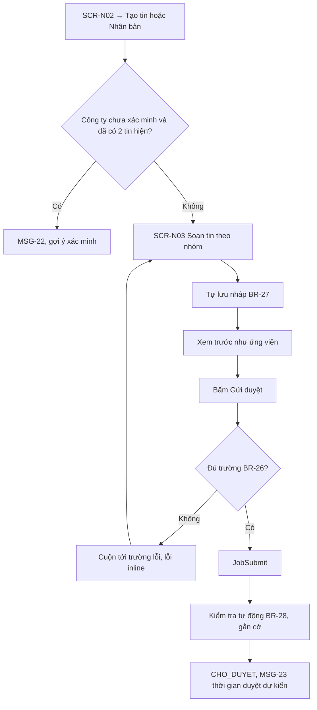
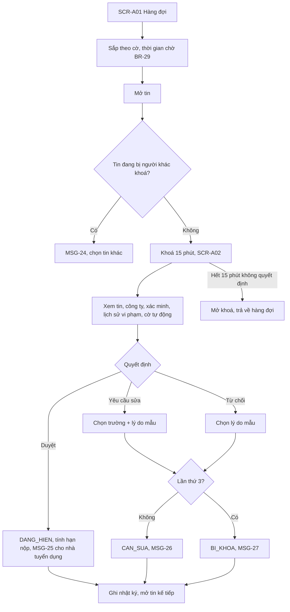
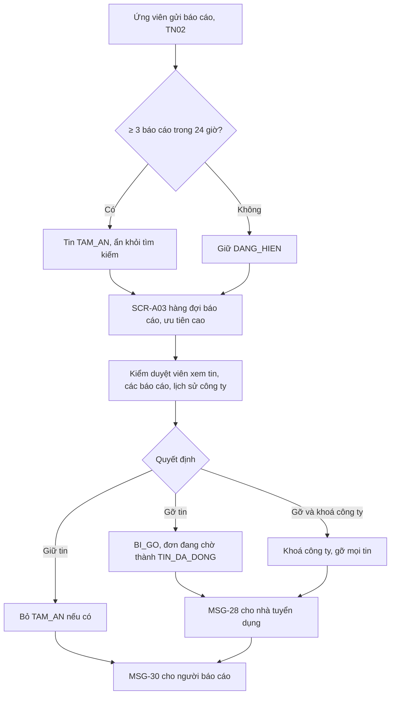
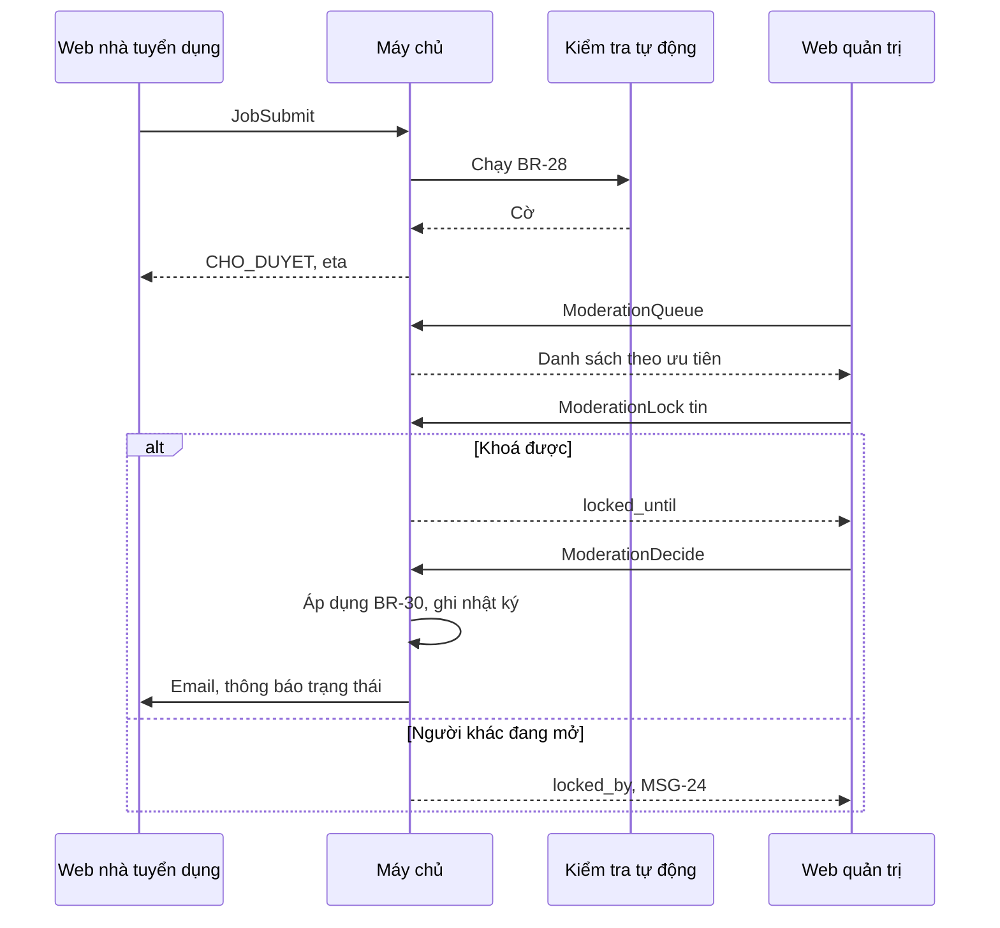

> **Mã:** DE05-TN03-SRS · **Trạng thái:** nháp · **Người viết:** Design (mock) · **PRD:** [PRD.md](PRD.md)

# UC-DE05-03 - Đăng tin tuyển dụng và kiểm duyệt

> **Bản mock.** Giá trị `[giả định]` cần BA xác nhận. Tin hiển thị cho ứng viên xem [SRS TN02](../TN02-tim-viec-ung-tuyen/SRS.md).

## 1. Tổng quan

| **Mục** | **Nội dung** |
| --- | --- |
| Mục tiêu | Nhà tuyển dụng xác minh công ty, đăng và quản lý tin; kiểm duyệt viên duyệt tin và xử lý báo cáo vi phạm |
| Actor | Nhà tuyển dụng · Kiểm duyệt viên · Web nhà tuyển dụng · Web quản trị · Máy chủ · Bộ kiểm tra tự động · Ứng viên (gửi báo cáo) |
| Phạm vi | Hồ sơ và xác minh công ty, soạn tin, nháp, gửi duyệt, sửa, đóng, mở lại, nhân bản; hàng đợi duyệt, quyết định duyệt; báo cáo, gỡ tin, khoá công ty |
| Ngoài phạm vi | Gói trả phí, nhiều tài khoản nhân sự, duyệt bằng AI hoàn toàn, đăng tin hàng loạt |
| Nền tảng | Web nhà tuyển dụng, Web quản trị (desktop) `[giả định]` |
| Figma | `[chưa có]` |

## 2. User Story

| **ID** | **As a** | **I want** | **So that** |
| --- | --- | --- | --- |
| US-12 | Nhà tuyển dụng | Xác minh công ty | Tin có nhãn xác minh, đăng được nhiều tin |
| US-13 | Nhà tuyển dụng | Soạn tin theo mẫu, xem trước | Tin đầy đủ, được duyệt ngay |
| US-14 | Nhà tuyển dụng | Biết vì sao tin bị từ chối | Sửa đúng chỗ |
| US-15 | Nhà tuyển dụng | Đóng, mở lại, nhân bản tin | Quản lý tin dễ dàng |
| US-16 | Kiểm duyệt viên | Hàng đợi có ưu tiên, cảnh báo tự động | Duyệt nhanh, đúng |
| US-17 | Kiểm duyệt viên | Xử lý báo cáo vi phạm | Gỡ tin lừa đảo kịp thời |

## 3. Business Rules

| **Mã** | **Quy tắc** |
| --- | --- |
| BR-23 | **Hồ sơ công ty** bắt buộc trước khi soạn tin: tên, mã số thuế (10 hoặc 13 số), địa chỉ, quy mô, ngành; logo và giới thiệu tuỳ chọn |
| BR-24 | **Xác minh công ty**: (a) ảnh giấy phép kinh doanh khớp tên và mã số thuế, do kiểm duyệt viên xét; hoặc (b) xác nhận link gửi tới email có tên miền trùng website công ty. Kết quả: `DA_XAC_MINH` hoặc `BI_TU_CHOI` kèm lý do |
| BR-25 | **Công ty chưa xác minh**: tối đa 2 tin `DANG_HIEN` cùng lúc; tin không có nhãn xác minh `[giả định]` |
| BR-26 | **Trường bắt buộc của tin**: chức danh (5–100 ký tự), ngành, hình thức, số lượng (1–100), lương (min ≤ max, triệu/tháng; hoặc "Thoả thuận" kèm lý do ≥ 20 ký tự), kinh nghiệm, địa chỉ làm việc (≥ 1), mô tả (100–5.000 ký tự), yêu cầu (≥ 30 ký tự), hạn nộp (7–60 ngày từ ngày duyệt), có yêu cầu CV hay không |
| BR-27 | **Nháp** tự lưu mỗi 10 giây khi có thay đổi; giữ 90 ngày |
| BR-28 | **Kiểm tra tự động** khi gửi duyệt, gắn cờ cho kiểm duyệt viên: từ khoá cấm (đóng phí, đặt cọc, việc nhẹ lương cao…); lương max > 3 lần trung vị ngành; số điện thoại, link chat ngoài sàn trong mô tả; nội dung trùng ≥ 90% tin khác |
| BR-29 | **Hàng đợi duyệt**: ưu tiên tin có cờ, sau đó theo thời gian chờ lâu nhất. Mở tin để duyệt → khoá cho kiểm duyệt viên đó 15 phút |
| BR-30 | **Quyết định**: `DUYET` → tin `DANG_HIEN`, tính hạn nộp từ lúc duyệt; `YEU_CAU_SUA` → tin `CAN_SUA`, kèm trường và lý do mẫu; `TU_CHOI` → tin `BI_TU_CHOI`, kèm lý do mẫu. Bị yêu cầu sửa hoặc từ chối 3 lần → tin `BI_KHOA` |
| BR-31 | **Sửa tin đang hiện**: đổi chức danh, lương, mô tả, yêu cầu, địa chỉ → bản sửa vào duyệt, bản cũ vẫn hiện tới khi bản sửa được duyệt. Đổi hạn nộp, số lượng → áp dụng ngay |
| BR-32 | **Đóng, mở lại**: đóng chủ động hoặc hết hạn → `DA_DONG`. Mở lại trong 30 ngày → `DANG_HIEN` với hạn nộp mới; quá 30 ngày → phải gửi duyệt lại |
| BR-33 | **Báo cáo vi phạm**: lý do Lừa đảo, Sai thông tin, Nội dung không phù hợp, Khác. ≥ 3 báo cáo từ 3 ứng viên khác nhau trong 24 giờ → tin `TAM_AN` |
| BR-34 | **Xử lý báo cáo**: `GIU_TIN` → bỏ `TAM_AN`; `GO_TIN` → tin `BI_GO`, mọi đơn đang chờ chuyển `TIN_DA_DONG`; `GO_VA_KHOA` → thêm khoá công ty, mọi tin của công ty bị gỡ |
| BR-35 | Mọi quyết định của kiểm duyệt viên ghi nhật ký: ai, lúc nào, quyết định, lý do |

## 4. Trạng thái

### 4.1 Trạng thái tin

| **Trạng thái** | **Ứng viên thấy** | **Nhà tuyển dụng làm được** |
| --- | --- | --- |
| `NHAP` | Không | Sửa, gửi duyệt, xoá |
| `CHO_DUYET` | Không | Xem; rút lại về nháp |
| `CAN_SUA` | Không | Sửa theo lý do, gửi lại |
| `BI_TU_CHOI` | Không | Xem lý do, sửa, gửi lại |
| `DANG_HIEN` | Có | Sửa (BR-31), đóng, nhân bản, xem ứng viên |
| `TAM_AN` | Không | Xem; chờ xử lý |
| `DA_DONG` | Không (đơn cũ vẫn xử lý được) | Mở lại, nhân bản, xem ứng viên |
| `BI_GO`, `BI_KHOA` | Không | Xem lý do, liên hệ hỗ trợ |

### 4.2 Trạng thái xác minh công ty

`CHUA_XAC_MINH` → `DANG_XET` → `DA_XAC_MINH` hoặc `BI_TU_CHOI` → (gửi lại) `DANG_XET` · `DA_XAC_MINH` → `BI_KHOA` khi gỡ và khoá (BR-34).

## 5. Use Case

### UC-08 Xác minh công ty

| **Mục** | **Nội dung** |
| --- | --- |
| Tiền điều kiện | Nhà tuyển dụng có hồ sơ công ty (BR-23) |
| Hậu điều kiện thành công | Công ty `DA_XAC_MINH`; tin có nhãn xác minh, bỏ giới hạn 2 tin |
| Hậu điều kiện thất bại | Công ty `BI_TU_CHOI` kèm lý do |

### UC-09 Soạn và gửi tin

| **Mục** | **Nội dung** |
| --- | --- |
| Tiền điều kiện | Có hồ sơ công ty; công ty không `BI_KHOA` |
| Hậu điều kiện thành công | Tin `CHO_DUYET`, có cờ tự động nếu có |
| Hậu điều kiện thất bại | Tin `NHAP` |

**Luồng chính**

| **Bước** | **Actor** | **Mô tả** |
| --- | --- | --- |
| 1 | Nhà tuyển dụng | **SCR-N02** → "Tạo tin" |
| 2 | Web | Kiểm tra BR-25; mở **SCR-N03** |
| 3 | Nhà tuyển dụng | Điền theo nhóm; hệ thống tự lưu nháp (BR-27) |
| 4 | Nhà tuyển dụng | Bấm "Xem trước", rồi "Gửi duyệt" |
| 5 | Web | Kiểm tra BR-26; hợp lệ → \[JobSubmit\] |
| 6 | Máy chủ | Chạy kiểm tra tự động (BR-28); tin `CHO_DUYET`; vào hàng đợi (BR-29) |
| 7 | Web | Hiện MSG-23 |

**Luồng thay thế**

| **Mã** | **Điều kiện** | **Xử lý** |
| --- | --- | --- |
| A1 | Nhân bản tin cũ | Mở **SCR-N03** với nội dung tin cũ, xoá hạn nộp |
| A2 | Lương "Thoả thuận" | Bắt buộc ô lý do (BR-26) |
| A3 | Rút lại khi `CHO_DUYET` | Về `NHAP`, rời hàng đợi |
| A4 | Rời trang khi có thay đổi chưa tự lưu | Hỏi xác nhận |

### UC-10 Kiểm duyệt tin

| **Mục** | **Nội dung** |
| --- | --- |
| Tiền điều kiện | Kiểm duyệt viên đăng nhập Web quản trị; có tin `CHO_DUYET` |
| Hậu điều kiện | Tin có quyết định; nhà tuyển dụng được báo; nhật ký ghi (BR-35) |

**Luồng chính**

| **Bước** | **Actor** | **Mô tả** |
| --- | --- | --- |
| 1 | Kiểm duyệt viên | Mở **SCR-A01**, chọn tin đầu hàng đợi |
| 2 | Máy chủ | Khoá tin 15 phút cho kiểm duyệt viên (BR-29) |
| 3 | Kiểm duyệt viên | Đọc tin, xem cờ tự động, hồ sơ và lịch sử công ty ở **SCR-A02** |
| 4 | Kiểm duyệt viên | Chọn quyết định, lý do (nếu cần) |
| 5 | Máy chủ | Áp dụng BR-30; báo nhà tuyển dụng; ghi nhật ký |
| 6 | Web quản trị | Tự mở tin kế tiếp |

### UC-11 Xử lý báo cáo vi phạm

| **Mục** | **Nội dung** |
| --- | --- |
| Tiền điều kiện | Có báo cáo từ ứng viên (SRS TN02) |
| Hậu điều kiện | Báo cáo có kết quả; tin, công ty xử lý theo BR-34; người báo cáo được báo |

## 6. Điểm vào

| **Điểm vào** | **Dẫn tới** | **Ghi chú** |
| --- | --- | --- |
| Đăng ký nhà tuyển dụng xong | **SCR-N01** tạo hồ sơ công ty | |
| Banner "Xác minh công ty" ở **SCR-N02** | UC-08 | Khi chưa xác minh |
| **SCR-N02** → Tạo tin, Nhân bản | UC-09 | |
| Email, thông báo trạng thái tin | Tin tương ứng ở **SCR-N02** | |
| Web quản trị → Hàng đợi duyệt | UC-10, **SCR-A01** | |
| Web quản trị → Báo cáo | UC-11, **SCR-A03** | |

## 7. Mô tả màn hình

### SCR-N01 Hồ sơ & xác minh công ty

| **#** | **Thành phần** | **Loại** | **Bắt buộc** | **Validate / hành vi** |
| --- | --- | --- | --- | --- |
| 1 | Tên công ty | Text | Có | 2–150 ký tự |
| 2 | Mã số thuế | Text | Có | 10 hoặc 13 số |
| 3 | Địa chỉ, quy mô, ngành | Text, select | Có | BR-23 |
| 4 | Website | URL | Không | Dùng cho xác minh email |
| 5 | Logo, giới thiệu | Upload, text | Không | Logo ≤ 2 MB |
| 6 | Trạng thái xác minh | Badge | – | Theo mục 4.2, kèm lý do khi bị từ chối |
| 7 | Xác minh | 2 lựa chọn | – | Email tên miền · Giấy phép kinh doanh |

### SCR-N02 Danh sách tin

| **#** | **Thành phần** | **Loại** | **Hành vi** |
| --- | --- | --- | --- |
| 1 | Tab trạng thái | Tabs | Nháp, Chờ duyệt, Cần sửa, Đang hiển thị, Đã đóng, Khác (Bị từ chối, Tạm ẩn, Bị gỡ, Bị khoá); kèm số lượng |
| 2 | Bảng tin | Table | Chức danh, trạng thái, ngày gửi hoặc duyệt, hạn nộp, số ứng viên mới / tổng |
| 3 | Lý do | Inline | Ở tin `CAN_SUA`, `BI_TU_CHOI`, `BI_GO`: lý do và nút "Sửa" |
| 4 | Hành động | Menu | Sửa, Xem trước, Đóng, Mở lại, Nhân bản, Xem ứng viên (TN04) |
| 5 | Tạo tin | Button | Kiểm tra BR-25 |

### SCR-N03 Soạn tin

| **#** | **Thành phần** | **Loại** | **Hành vi** |
| --- | --- | --- | --- |
| 1 | Nhóm trường | Sections | Thông tin chung · Lương và quyền lợi · Mô tả và yêu cầu · Địa điểm · Hạn nộp và CV; theo BR-26 |
| 2 | Lý do cần sửa | Banner + đánh dấu trường | Khi mở từ `CAN_SUA`, `BI_TU_CHOI` |
| 3 | Trạng thái lưu | Text phụ | "Đã lưu nháp lúc {giờ}" |
| 4 | Xem trước | Panel | Giao diện chi tiết tin trên điện thoại |
| 5 | Gửi duyệt | Button | Kiểm tra BR-26 |

### SCR-A01 Hàng đợi kiểm duyệt

| **#** | **Thành phần** | **Loại** | **Hành vi** |
| --- | --- | --- | --- |
| 1 | Bộ đếm | Stats | Số tin chờ, chờ lâu nhất, số có cờ |
| 2 | Bảng | Table | Chức danh, công ty, xác minh, cờ tự động, thời gian chờ, người đang mở |
| 3 | Bắt đầu duyệt | Button | Mở tin đầu hàng đợi chưa bị khoá |

### SCR-A02 Chi tiết duyệt tin

| **#** | **Thành phần** | **Loại** | **Hành vi** |
| --- | --- | --- | --- |
| 1 | Nội dung tin | Panel trái | Tô sáng đoạn bị cờ tự động |
| 2 | Cờ tự động | List | Theo BR-28, kèm đoạn trích |
| 3 | Công ty | Panel phải | Hồ sơ, xác minh, số tin, lịch sử vi phạm |
| 4 | Lần gửi trước | Timeline | Các lần yêu cầu sửa, từ chối và lý do |
| 5 | Quyết định | Buttons | Duyệt · Yêu cầu sửa · Từ chối; lý do mẫu chọn nhiều, ghi chú thêm |
| 6 | Đồng hồ khoá | Text | "Còn {mm:ss}" |

### SCR-A03 Báo cáo vi phạm

| **#** | **Thành phần** | **Loại** | **Hành vi** |
| --- | --- | --- | --- |
| 1 | Bảng báo cáo | Table | Tin, công ty, số báo cáo, lý do, trạng thái tin (`TAM_AN`), thời gian |
| 2 | Chi tiết | Panel | Nội dung từng báo cáo, nội dung tin, lịch sử công ty |
| 3 | Quyết định | Buttons | Giữ tin · Gỡ tin · Gỡ và khoá công ty (cần xác nhận lần hai) |

## 8. API

| **API** | **Request chính** | **Response chính** | **Timeout / retry** `[giả định]` |
| --- | --- | --- | --- |
| \[CompanySave\] | Thông tin công ty | company_id | 5s / 2 lần |
| \[CompanyVerifyEmail\] | email | Gửi link; lỗi khi tên miền không khớp | 5s / 1 lần |
| \[CompanyVerifyLicense\] | Ảnh giấy phép | status `DANG_XET` | 15s / 1 lần |
| \[JobDraftSave\] | job_id, các trường | saved_at | 5s / tự lưu lại lần sau |
| \[JobSubmit\] | job_id | status `CHO_DUYET`, flags, eta | 8s / 2 lần |
| \[JobAction\] | job_id, action (CLOSE, REOPEN, DUPLICATE, WITHDRAW) | status mới | 5s / 2 lần |
| \[ModerationQueue\] | type (JOB, REPORT, LICENSE), cursor | Danh sách, bộ đếm | 5s / 1 lần |
| \[ModerationLock\] | item_id | locked_until hoặc locked_by | 3s / 1 lần |
| \[ModerationDecide\] | item_id, decision, reasons, fields, note | status mới | 5s / 2 lần |

## 9. Danh sách thông báo

| **ID** | **Nơi hiện** | **Nội dung (VI)** |
| --- | --- | --- |
| MSG-19 | Inline **SCR-N01** | Email cần có tên miền trùng với website công ty |
| MSG-20 | Banner | Công ty đã được xác minh. Tin của bạn sẽ hiện nhãn "Đã xác minh" |
| MSG-21 | Banner, email | Chưa xác minh được công ty: {lý do}. Vui lòng gửi lại |
| MSG-22 | Popup | Công ty chưa xác minh chỉ đăng được 2 tin cùng lúc. \[Xác minh ngay\] |
| MSG-23 | Toast | Đã gửi duyệt. Thời gian duyệt dự kiến: trong {n} giờ làm việc |
| MSG-24 | Toast (quản trị) | Tin đang được {tên} duyệt |
| MSG-25 | Email, thông báo | Tin "{chức danh}" đã được duyệt và đang hiển thị |
| MSG-26 | Email, thông báo | Tin "{chức danh}" cần chỉnh sửa: {lý do}. \[Sửa tin\] |
| MSG-27 | Email, banner | Tin "{chức danh}" đã bị khoá do bị từ chối 3 lần. Vui lòng liên hệ hỗ trợ |
| MSG-28 | Email, banner | Tin "{chức danh}" đã bị gỡ vì vi phạm: {lý do} |
| MSG-29 | Banner **SCR-N02** | Tin "{chức danh}" đang tạm ẩn để kiểm tra theo báo cáo của người dùng |
| MSG-30 | Thông báo (ứng viên) | Cảm ơn bạn. Tin bạn báo cáo đã được {gỡ / kiểm tra và giữ lại} |

Bản EN: `[chờ bổ sung]`.

## 10. Yêu cầu phi chức năng

| **Mục** | **Yêu cầu** `[giả định]` |
| --- | --- |
| Hiệu năng | Tự lưu nháp ≤ 1 giây; kiểm tra tự động ≤ 5 giây; tin được duyệt hiện trong tìm kiếm ≤ 1 phút |
| Bảo mật | Ảnh giấy phép chỉ kiểm duyệt viên xem; Web quản trị yêu cầu đăng nhập hai lớp |
| Audit | Nhật ký quyết định giữ 2 năm (BR-35); không sửa, không xoá được |
| Tính nhất quán | Khoá duyệt tránh hai người cùng quyết định một tin |
| Tracking | Tạo tin, gửi duyệt, cờ tự động, thời gian duyệt, quyết định, lý do, xác minh công ty, báo cáo, gỡ tin |
| Accessibility | Form có nhãn, lỗi inline gắn với trường; Web quản trị dùng được bằng bàn phím (phím tắt cho 3 quyết định) |
