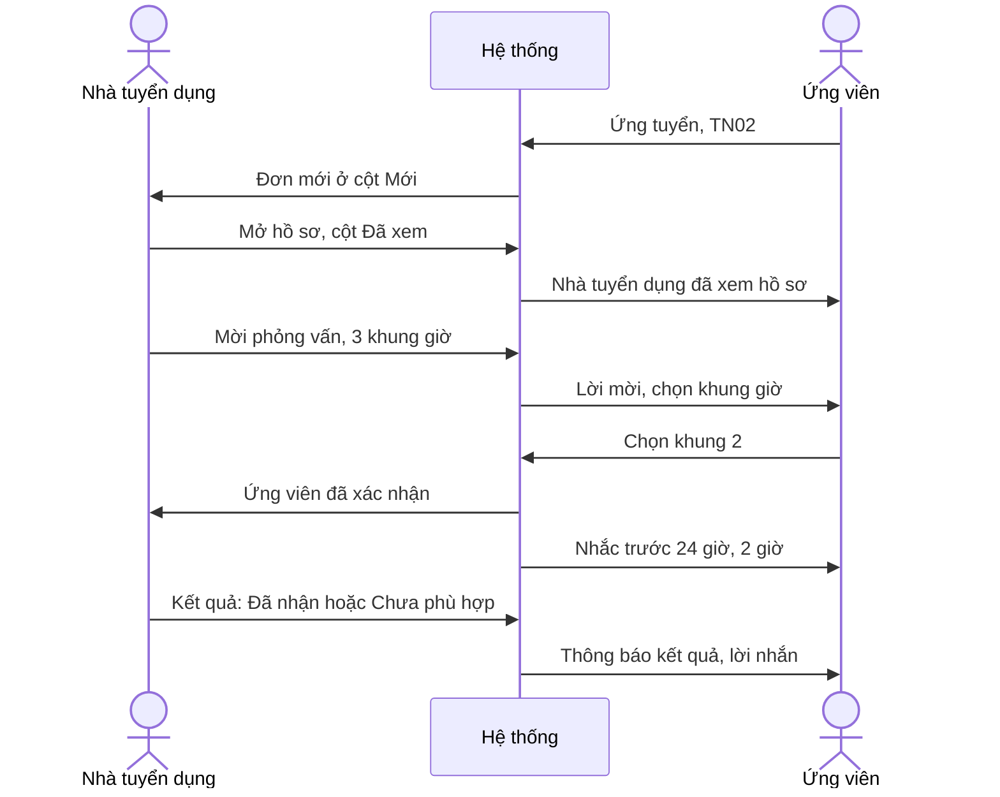

> **Mã:** DE05-TN04-PRD · **Trạng thái:** nháp · **Người viết:** Design (mock) · **SRS:** [SRS.md](SRS.md)

# PRD Xử lý hồ sơ và hẹn phỏng vấn (App tìm việc)

> **Bản mock.** Con số đánh dấu `[giả định]` dùng để dựng flow, cần PO xác nhận trước khi dùng.

## 1. Bối cảnh và vấn đề

### 1.1 Bối cảnh

Khi ứng viên ứng tuyển ([TN02](../TN02-tim-viec-ung-tuyen/PRD.md)), đơn vào danh sách của nhà tuyển dụng. Nhà tuyển dụng nhỏ thường quản lý ứng viên bằng email và bảng tính, gọi điện hẹn phỏng vấn rồi quên báo kết quả. Tính năng này cho nhà tuyển dụng một pipeline đơn giản, và ứng viên luôn biết mình đang ở bước nào.

### 1.2 Vấn đề

| **Vấn đề** | **Hệ quả** |
| --- | --- |
| Hồ sơ dồn trong email, không biết đã xem ai | Bỏ sót ứng viên tốt |
| Không ghi chú được về ứng viên | Quên đánh giá sau phỏng vấn |
| Hẹn phỏng vấn qua điện thoại | Ứng viên quên, đến sai giờ, sai địa chỉ |
| Không báo kết quả cho ứng viên bị loại | Ứng viên chờ mãi, mất thiện cảm với công ty |
| Đổi lịch phỏng vấn rối rắm | Hai bên lỡ hẹn |

### 1.3 Mục tiêu

- ≥ 70% đơn được xem trong 7 ngày `[giả định]`.
- ≥ 80% đơn có kết quả cuối (nhận hoặc chưa phù hợp) trong 30 ngày `[giả định]`.
- Tỉ lệ ứng viên không đến phỏng vấn ≤ 20% `[giả định]`.

## 2. Người dùng

| **Nhóm** | **Nhu cầu với tính năng này** |
| --- | --- |
| Nhà tuyển dụng doanh nghiệp nhỏ | Xem nhanh, phân loại ứng viên, hẹn lịch trong vài thao tác |
| Nhân sự công ty lớn | Lọc nhiều hồ sơ, ghi chú, từ chối hàng loạt kèm lời nhắn |
| Ứng viên | Biết lịch phỏng vấn rõ ràng, xác nhận hoặc xin đổi; được báo kết quả |

## 3. Phạm vi

### 3.1 Trong phạm vi (MVP)

- Pipeline theo tin: Mới, Đã xem, Phỏng vấn, Đã nhận, Chưa phù hợp; cột Đã rút chỉ xem.
- Chi tiết ứng viên: hồ sơ đã gửi, CV, lời nhắn, liên hệ, ghi chú nội bộ, gắn sao.
- Đổi trạng thái từng đơn hoặc nhiều đơn; từ chối kèm lời nhắn mẫu.
- Hẹn phỏng vấn: trực tiếp hoặc online (link), chọn 1–3 khung giờ để ứng viên chọn.
- Ứng viên xác nhận khung giờ, xin đổi, huỷ; nhắc lịch trước 24 giờ và 2 giờ.
- Nhắc nhà tuyển dụng đơn chưa xem.

### 3.2 Ngoài phạm vi

- Gọi video phỏng vấn trong app.
- Nhắn tin tự do giữa hai bên → phase sau.
- Đồng bộ lịch Google, Outlook.
- Bảng đánh giá phỏng vấn nhiều người, điểm số.
- Gửi thư mời nhận việc chính thức.

## 4. Nguyên tắc sản phẩm

### 4.1 Mỗi ứng viên một trạng thái rõ ràng

Nhà tuyển dụng thấy ứng viên theo cột; ứng viên thấy đúng trạng thái đó bằng lời dễ hiểu.

### 4.2 Hẹn lịch để ứng viên chọn

Nhà tuyển dụng đưa vài khung giờ, ứng viên chọn khung phù hợp. Ít gọi điện qua lại.

### 4.3 Từ chối tử tế

Từ chối luôn gửi lời nhắn lịch sự, có mẫu sẵn. Ghi chú nội bộ không bao giờ hiện cho ứng viên.

### 4.4 Không để đơn chìm

Đơn mới quá lâu chưa xem thì nhắc nhà tuyển dụng; ứng viên được nói thật khi chưa có phản hồi.

## 5. Quy tắc nghiệp vụ

| **Quy tắc** | **Giá trị** `[giả định]` |
| --- | --- |
| Cột pipeline | Mới, Đã xem, Phỏng vấn, Đã nhận, Chưa phù hợp, Đã rút |
| Tự chuyển Đã xem | Khi nhà tuyển dụng mở chi tiết ứng viên lần đầu |
| Khung giờ phỏng vấn | 1–3 khung; mỗi khung 15–120 phút; sớm nhất sau 24 giờ |
| Ứng viên trả lời lời mời | Trong 48 giờ; quá hạn → nhà tuyển dụng được báo, đơn về Đã xem để hai bên xử lý tiếp |
| Nhắc lịch | 24 giờ và 2 giờ trước giờ phỏng vấn |
| Xin đổi lịch | Ứng viên đổi tối đa 1 lần mỗi lời mời |
| Ghi chú nội bộ | ≤ 1.000 ký tự, chỉ nhà tuyển dụng thấy |
| Nhắc đơn chưa xem | Email tóm tắt hằng ngày khi có đơn Mới quá 3 ngày |

- Các giá trị trên là **cấu hình**, không cố định trong code.

## 6. Luồng trải nghiệm

| **Bước** | **Vai trò** | **Trải nghiệm** | **Đầu ra** |
| --- | --- | --- | --- |
| 1 | Nhà tuyển dụng | Pipeline của tin, cột Mới có badge | Biết có ứng viên mới |
| 2 | Nhà tuyển dụng | Mở hồ sơ, xem CV, ghi chú, gắn sao | Đơn Đã xem |
| 3 | Nhà tuyển dụng | Mời phỏng vấn: hình thức, địa điểm hoặc link, khung giờ | Lời mời |
| 4 | Ứng viên | Nhận lời mời, chọn khung giờ, hoặc xin đổi | Lịch đã chốt |
| 5 | Cả hai | Nhắc lịch trước 24 giờ, 2 giờ | Đến đúng hẹn |
| 6 | Nhà tuyển dụng | Chọn kết quả, gửi lời nhắn | Đơn có kết quả |

## 7. Use Cases, User Stories và Acceptance Criteria

### UC1. Xem và phân loại ứng viên

#### US1.1 Xem pipeline

User Story: Là nhà tuyển dụng, tôi muốn thấy ứng viên của từng tin theo trạng thái để không bỏ sót ai.

AC01: Chọn tin → pipeline dạng cột với số lượng mỗi cột; xem dạng danh sách được.

AC02: Thẻ ứng viên: tên, vị trí hiện tại hoặc gần nhất, số năm kinh nghiệm, ngày ứng tuyển, sao, có CV hay không.

AC03: Lọc theo đã gắn sao, có CV, kinh nghiệm; tìm theo tên.

#### US1.2 Xem chi tiết ứng viên

User Story: Là nhà tuyển dụng, tôi muốn xem chi tiết ứng viên, ghi chú và gắn sao để nhớ đánh giá của mình.

AC01: Chi tiết hiện hồ sơ đã gửi, CV (xem trong trang, tải về), lời nhắn, số điện thoại, email.

AC02: Mở lần đầu → đơn tự chuyển Đã xem; ứng viên được báo.

AC03: Ghi chú nội bộ và gắn sao; ghi rõ "Chỉ bạn thấy".

AC04: Đơn đã rút → ẩn liên hệ và CV, hiện "Ứng viên đã rút đơn".

### UC2. Hẹn phỏng vấn

#### US2.1 Gửi lời mời

User Story: Là nhà tuyển dụng, tôi muốn gửi vài khung giờ để ứng viên chọn mà không cần gọi điện qua lại.

AC01: Chọn hình thức Trực tiếp (địa chỉ, người liên hệ) hoặc Online (link họp).

AC02: Chọn 1–3 khung giờ, thời lượng; khung sớm nhất sau 24 giờ.

AC03: Lời nhắn kèm theo, có mẫu.

AC04: Gửi xong → đơn chuyển Phỏng vấn, chờ ứng viên chọn.

#### US2.2 Ứng viên trả lời

User Story: Là ứng viên, tôi muốn chọn khung giờ hoặc xin đổi để đi phỏng vấn đúng lịch.

AC01: Ứng viên thấy lời mời: công ty, vị trí, hình thức, địa chỉ hoặc link, các khung giờ.

AC02: Chọn một khung → xác nhận; thêm vào lịch điện thoại được.

AC03: "Không khung nào phù hợp" → xin đổi kèm gợi ý thời gian; tối đa 1 lần.

AC04: Từ chối phỏng vấn → hỏi xác nhận; đơn chuyển Chưa phù hợp với lý do "Ứng viên từ chối".

AC05: Không trả lời trong 48 giờ → nhà tuyển dụng được báo, có thể gửi lại; đơn về Đã xem nên ứng viên rút đơn được.

#### US2.3 Nhắc và đổi lịch

User Story: Là ứng viên hoặc nhà tuyển dụng, tôi muốn được nhắc trước giờ phỏng vấn và được báo khi lịch thay đổi để không lỡ hẹn.

AC01: Nhắc cả hai bên trước 24 giờ và 2 giờ.

AC02: Nhà tuyển dụng đổi hoặc huỷ lịch đã chốt → ứng viên được báo ngay, kèm lý do.

### UC3. Báo kết quả

#### US3.1 Nhận hoặc từ chối

User Story: Là nhà tuyển dụng, tôi muốn gửi kết quả nhận hoặc chưa phù hợp kèm lời nhắn để ứng viên không phải chờ trong im lặng.

AC01: Chọn Đã nhận hoặc Chưa phù hợp cho từng đơn hoặc nhiều đơn.

AC02: Chưa phù hợp → chọn lời nhắn mẫu, sửa được; gửi kèm cho ứng viên.

AC03: Đã nhận → lời nhắn chúc mừng và bước tiếp theo (tự soạn).

AC04: Đổi kết quả đã gửi (Đã nhận ↔ Chưa phù hợp, trong 30 ngày) → hỏi xác nhận; ứng viên được báo lại.

## 8. Chỉ số theo dõi `[giả định]`

| **Chỉ số** | **Định nghĩa** | **Mục tiêu MVP** |
| --- | --- | --- |
| Tỉ lệ đơn được xem trong 7 ngày | Đơn Đã xem trong 7 ngày / đơn mới | ≥ 70% |
| Tỉ lệ có kết quả trong 30 ngày | Đơn Đã nhận hoặc Chưa phù hợp / đơn mới | ≥ 80% |
| Tỉ lệ ứng viên trả lời lời mời | Lời mời được chọn khung giờ / lời mời gửi | ≥ 75% |
| Tỉ lệ không đến | Phỏng vấn đánh dấu không đến / phỏng vấn đã chốt | ≤ 20% |
| Thời gian tới phỏng vấn | Từ ứng tuyển tới lời mời | Theo dõi |
| Tỉ lệ từ chối có lời nhắn | Từ chối có lời nhắn / tổng từ chối | 100% (bắt buộc) |

## 9. Phụ thuộc và rủi ro

| **Mục** | **Mô tả** | **Hướng xử lý** |
| --- | --- | --- |
| Lộ dữ liệu ứng viên | Nhà tuyển dụng tải CV hàng loạt | Ghi nhật ký tải; giới hạn tải; ẩn khi đơn rút |
| Ghi chú lộ ra | Ghi chú nội bộ gửi nhầm cho ứng viên | Tách hẳn ghi chú và lời nhắn trong giao diện |
| Múi giờ, nhầm giờ | Ứng viên, công ty khác tỉnh vẫn cùng múi giờ; người ở nước ngoài có thể lệch | Hiện giờ kèm múi giờ khi khác múi giờ thiết bị |
| Nhà tuyển dụng không báo kết quả | Đơn treo | Nhắc; đơn treo khi tin đóng → Tin đã đóng (TN02) |

## 10. Câu hỏi mở

> Câu nào đã có giá trị ở mục 5 thì giá trị đó là **tạm chốt** `[giả định]` để dựng flow. Câu hỏi vẫn để mở cho đến khi PO xác nhận.

- Có cho nhắn tin tự do giữa hai bên ở MVP không?
- Có đánh dấu "Không đến" để ảnh hưởng hồ sơ ứng viên không?
- Từ chối hàng loạt có bắt buộc lời nhắn riêng?
- Có cần nhiều vòng phỏng vấn ở MVP?
