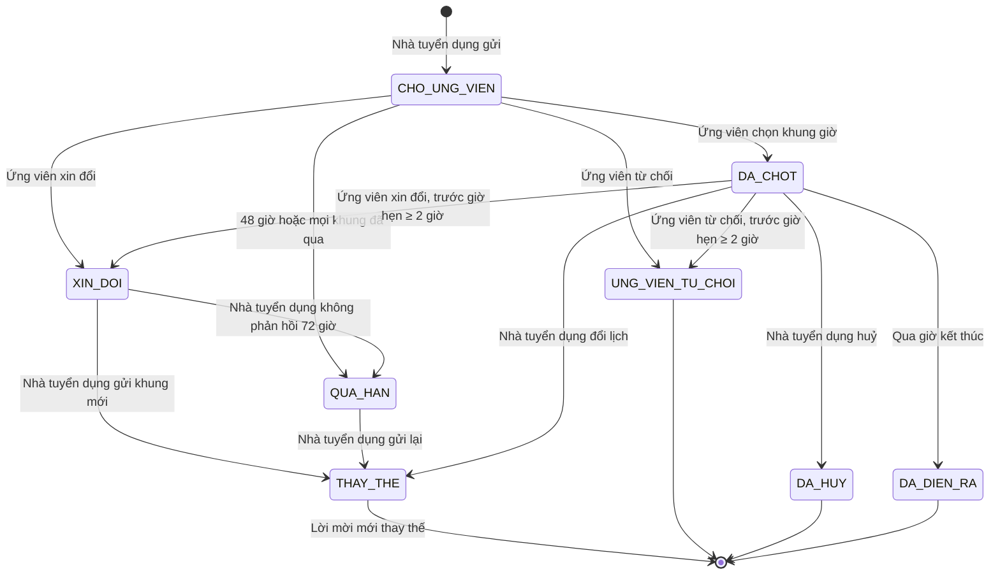
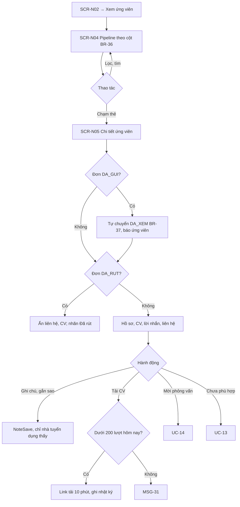
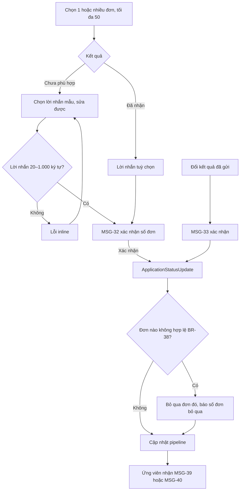
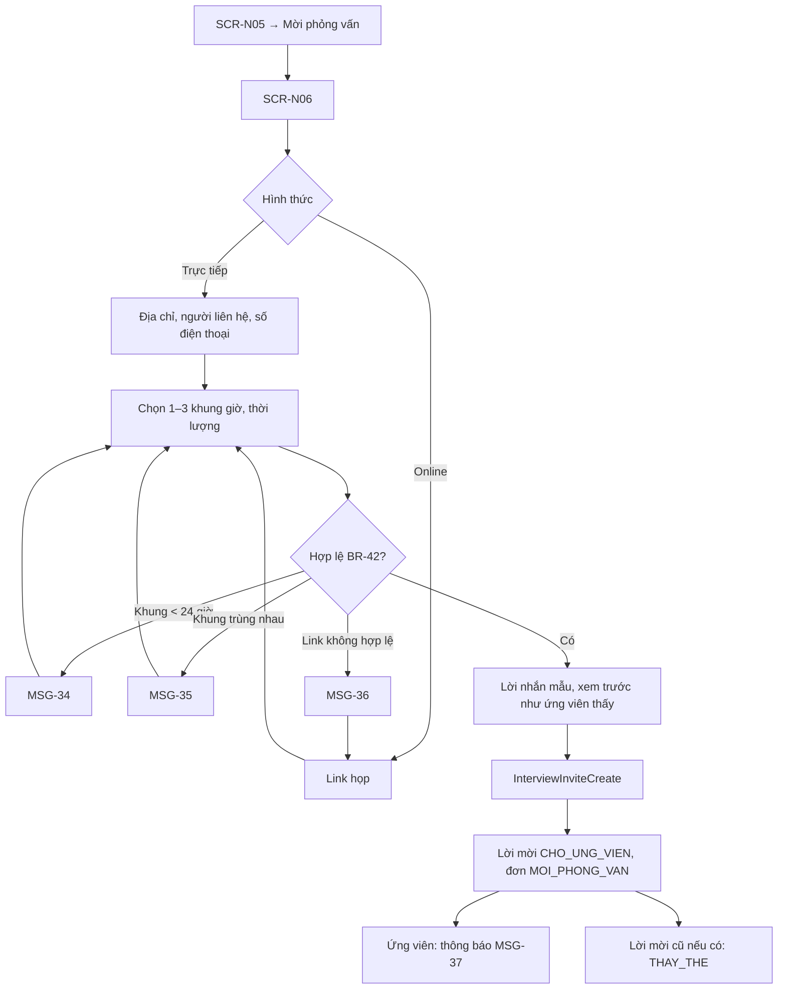
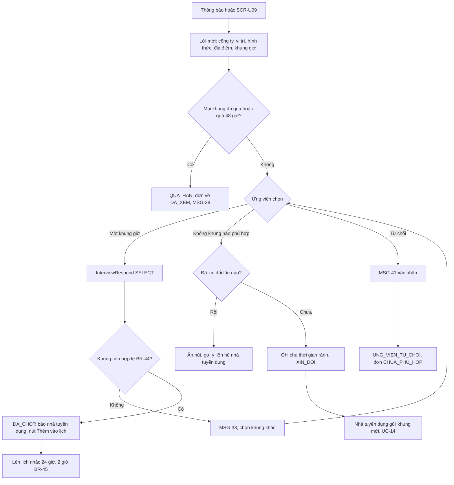
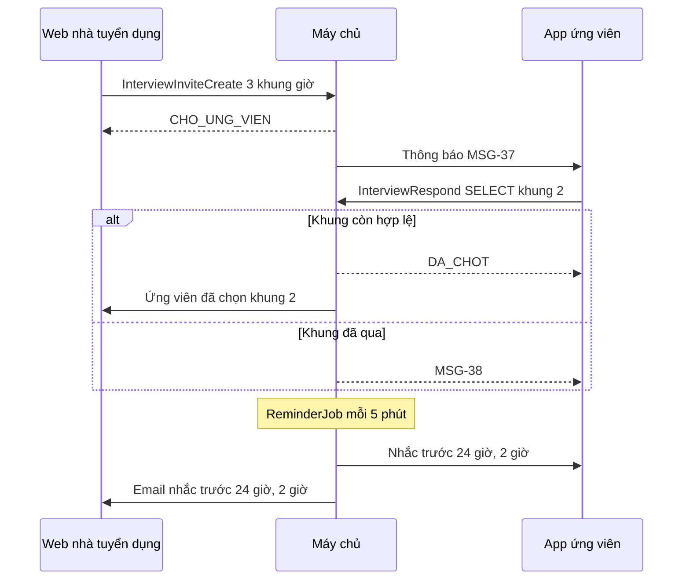

> **Mã:** DE05-TN04-SRS · **Trạng thái:** đã chốt · **Người viết:** Design · **PRD:** [PRD.md](PRD.md)

# UC-DE05-04 - Xử lý hồ sơ và hẹn phỏng vấn

> Trạng thái đơn định nghĩa ở [SRS TN02](../TN02-tim-viec-ung-tuyen/SRS.md), mục 4.1.

## 1. Tổng quan

| **Mục** | **Nội dung** |
| --- | --- |
| Mục tiêu | Nhà tuyển dụng xem, phân loại ứng viên, hẹn phỏng vấn, báo kết quả; ứng viên trả lời lời mời và nhận kết quả |
| Actor | Nhà tuyển dụng · Ứng viên · Web nhà tuyển dụng · App ứng viên · Máy chủ · Dịch vụ email, thông báo đẩy |
| Phạm vi | Pipeline, chi tiết ứng viên, ghi chú, gắn sao, đổi trạng thái, lời mời phỏng vấn, chọn khung giờ, xin đổi, nhắc lịch, kết quả |
| Ngoài phạm vi | Gọi video, nhắn tin tự do, đồng bộ lịch, bảng đánh giá nhiều người, thư mời nhận việc |
| Nền tảng | Web nhà tuyển dụng; App ứng viên iOS / Android |

## 2. User Story

| **ID** | **As a** | **I want** | **So that** |
| --- | --- | --- | --- |
| US-18 | Nhà tuyển dụng | Thấy ứng viên theo trạng thái | Không bỏ sót ai |
| US-19 | Nhà tuyển dụng | Ghi chú, gắn sao ứng viên | Nhớ đánh giá của mình |
| US-20 | Nhà tuyển dụng | Gửi khung giờ để ứng viên chọn | Hẹn nhanh, không gọi qua lại |
| US-21 | Ứng viên | Chọn khung giờ hoặc xin đổi | Đi phỏng vấn đúng lịch |
| US-22 | Cả hai | Được nhắc trước giờ phỏng vấn | Không lỡ hẹn |
| US-23 | Ứng viên | Nhận kết quả kèm lời nhắn | Không phải chờ trong im lặng |

## 3. Business Rules

| **Mã** | **Quy tắc** |
| --- | --- |
| BR-36 | **Cột pipeline** ánh xạ trạng thái đơn: Mới = `DA_GUI`, Đã xem = `DA_XEM`, Phỏng vấn = `MOI_PHONG_VAN`, Đã nhận = `DA_NHAN`, Chưa phù hợp = `CHUA_PHU_HOP`, Đã rút = `DA_RUT` (chỉ xem), Tin đã đóng = `TIN_DA_DONG` (chỉ xem) |
| BR-37 | **Tự chuyển `DA_XEM`** khi nhà tuyển dụng mở chi tiết đơn `DA_GUI` lần đầu |
| BR-38 | **Đổi trạng thái thủ công** cho phép: `DA_GUI`/`DA_XEM` → `CHUA_PHU_HOP`; `DA_XEM` → `MOI_PHONG_VAN` (qua UC-14); `MOI_PHONG_VAN` → `DA_NHAN` hoặc `CHUA_PHU_HOP`; `CHUA_PHU_HOP` → `DA_XEM` (mở lại, trong 30 ngày); **đổi kết quả đã gửi** (BR-47): `DA_NHAN` → `CHUA_PHU_HOP` và `CHUA_PHU_HOP` → `DA_NHAN`, trong 30 ngày kể từ khi gửi kết quả. Không đổi đơn `DA_RUT`, `TIN_DA_DONG`. Đơn của tin `DA_DONG` vẫn đổi được theo các chuyển trên trong 30 ngày kể từ khi tin đóng (TN02 BR-22) |
| BR-39 | **Chọn nhiều đơn**: đổi trạng thái tối đa 50 đơn mỗi lần, cùng một lời nhắn |
| BR-40 | **Liên hệ và CV** chỉ hiện với đơn khác `DA_RUT`. Mỗi lần tải CV ghi nhật ký; tối đa 200 lượt tải mỗi ngày mỗi công ty |
| BR-41 | **Ghi chú nội bộ** ≤ 1.000 ký tự mỗi ghi chú, nhiều ghi chú theo thời gian; **sao** 0–1. Cả hai không bao giờ trả về cho App ứng viên |
| BR-42 | **Lời mời phỏng vấn**: hình thức `TRUC_TIEP` (địa chỉ, người liên hệ, số điện thoại) hoặc `ONLINE` (link họp hợp lệ); 1–3 khung giờ, thời lượng 15–120 phút; khung sớm nhất ≥ 24 giờ từ lúc gửi; các khung không trùng nhau |
| BR-43 | **Trả lời lời mời**: ứng viên chọn 1 khung → lịch `DA_CHOT`; xin đổi (tối đa 1 lần) kèm ghi chú ≤ 200 ký tự → `XIN_DOI`; từ chối → đơn `CHUA_PHU_HOP` lý do "Ứng viên từ chối phỏng vấn". Quá 48 giờ không trả lời → lời mời `QUA_HAN`, đơn quay về `DA_XEM`, báo nhà tuyển dụng; từ `DA_XEM` nhà tuyển dụng gửi lại lời mời (UC-14) hoặc chọn Chưa phù hợp, ứng viên rút đơn được (TN02 BR-21). Lịch đã `DA_CHOT`, trước giờ bắt đầu ≥ 2 giờ: ứng viên vẫn xin đổi được (nếu chưa dùng lượt đổi) hoặc từ chối. Lời mời `XIN_DOI` mà nhà tuyển dụng không gửi khung mới trong 72 giờ → nhắc nhà tuyển dụng ở giờ thứ 48, hết 72 giờ chuyển `QUA_HAN`, đơn cũng quay về `DA_XEM` |
| BR-44 | **Khung giờ đã chọn** không còn hợp lệ nếu đã qua; ứng viên mở lời mời khi mọi khung đã qua → lời mời `QUA_HAN` |
| BR-45 | **Nhắc lịch** gửi cả hai bên 24 giờ và 2 giờ trước giờ bắt đầu, qua thông báo đẩy (ứng viên) và email (cả hai) |
| BR-46 | **Đổi, huỷ lịch đã chốt** bởi nhà tuyển dụng: bắt buộc lý do; đổi → gửi lời mời mới (BR-42) thay lời mời cũ; huỷ → đơn về `DA_XEM` |
| BR-47 | **Kết quả** `CHUA_PHU_HOP` bắt buộc lời nhắn (mẫu hoặc tự soạn, 20–1.000 ký tự). `DA_NHAN` có lời nhắn tuỳ chọn. Lịch `DA_DIEN_RA` có thêm lựa chọn "Ứng viên không đến" → đơn `CHUA_PHU_HOP` với lý do "Không tham gia phỏng vấn", không bắt buộc lời nhắn; không ảnh hưởng hồ sơ hay đơn khác của ứng viên. Đổi kết quả đã gửi theo các chuyển trạng thái ở BR-38 → hỏi xác nhận (MSG-33), ứng viên nhận thông báo mới; đổi sang `CHUA_PHU_HOP` vẫn bắt buộc lời nhắn. Nhắc nhà tuyển dụng qua email hằng ngày khi có đơn `DA_GUI` quá 3 ngày |

## 4. Trạng thái

### 4.1 Trạng thái lời mời phỏng vấn

### 4.2 Hai phía thấy gì

| **Trạng thái lời mời** | **Web nhà tuyển dụng** | **App ứng viên** |
| --- | --- | --- |
| `CHO_UNG_VIEN` | "Chờ ứng viên chọn giờ · còn {h} giờ" | Lời mời, các khung giờ, nút Chọn, Xin đổi, Từ chối |
| `XIN_DOI` | "Ứng viên xin đổi: {ghi chú}", nút Gửi khung mới | "Đã gửi yêu cầu đổi, chờ phản hồi" |
| `QUA_HAN` | "Ứng viên chưa trả lời" hoặc "Bạn chưa gửi khung giờ mới", nút Gửi lại; đơn về cột Đã xem | "Lời mời đã hết hạn"; đơn về "Nhà tuyển dụng đã xem hồ sơ", có nút Rút đơn |
| `DA_CHOT` | Lịch phỏng vấn, nút Đổi, Huỷ | Lịch, địa chỉ hoặc link, nút Thêm vào lịch; nút Xin đổi, Từ chối tới trước giờ hẹn 2 giờ |
| `DA_DIEN_RA` | Nút chọn kết quả: Đã nhận, Chưa phù hợp, Ứng viên không đến | "Đã phỏng vấn · Chờ kết quả" |

## 5. Use Case

### UC-12 Xem pipeline và chi tiết ứng viên

| **Mục** | **Nội dung** |
| --- | --- |
| Tiền điều kiện | Nhà tuyển dụng có tin `DANG_HIEN` hoặc `DA_DONG` |
| Hậu điều kiện | Đơn được xem chuyển `DA_XEM`; ghi chú, sao được lưu |

**Luồng chính**

| **Bước** | **Actor** | **Mô tả** |
| --- | --- | --- |
| 1 | Nhà tuyển dụng | Ở **SCR-N02**, bấm Xem ứng viên |
| 2 | Hệ thống | Hiện **SCR-N04** Pipeline theo cột (BR-36) |
| 3 | Nhà tuyển dụng | Chạm một thẻ ứng viên |
| 4 | Hệ thống | Mở **SCR-N05**; đơn `DA_GUI` tự chuyển `DA_XEM` (BR-37), ứng viên được báo |
| 5 | Hệ thống | Hiện hồ sơ, CV, lời nhắn, liên hệ |
| 6 | Nhà tuyển dụng | Ghi chú, gắn sao → \[NoteSave\], chỉ nhà tuyển dụng thấy |

**Luồng thay thế**

| **Mã** | **Điều kiện** | **Xử lý** |
| --- | --- | --- |
| A1 | Lọc, tìm ở pipeline | Cập nhật **SCR-N04** |
| A2 | Đơn `DA_RUT` | Ẩn liên hệ và CV, hiện nhãn "Đã rút" |
| A3 | Tải CV | Dưới 200 lượt trong ngày → link tải có hạn 10 phút, ghi nhật ký |
| A4 | Chọn Mời phỏng vấn | UC-14 |
| A5 | Chọn Chưa phù hợp | UC-13 |

**Luồng lỗi**

| **Mã** | **Điều kiện** | **Xử lý** |
| --- | --- | --- |
| E1 | Vượt 200 lượt tải CV trong ngày | MSG-31 |

### UC-13 Đổi trạng thái, báo kết quả

| **Mục** | **Nội dung** |
| --- | --- |
| Tiền điều kiện | Đơn ở trạng thái cho phép theo BR-38 |
| Hậu điều kiện | Đơn đổi trạng thái; ứng viên nhận thông báo kèm lời nhắn |

**Luồng chính**

| **Bước** | **Actor** | **Mô tả** |
| --- | --- | --- |
| 1 | Nhà tuyển dụng | Chọn 1 hoặc nhiều đơn (tối đa 50), chọn kết quả Chưa phù hợp |
| 2 | Nhà tuyển dụng | Chọn lời nhắn mẫu, sửa nếu cần |
| 3 | Hệ thống | Kiểm tra lời nhắn 20–1.000 ký tự; hiện MSG-32 xác nhận số đơn |
| 4 | Nhà tuyển dụng | Xác nhận |
| 5 | Hệ thống | Gọi \[ApplicationStatusUpdate\]; cập nhật pipeline |
| 6 | Hệ thống | Ứng viên nhận MSG-39 |

**Luồng thay thế**

| **Mã** | **Điều kiện** | **Xử lý** |
| --- | --- | --- |
| A1 | Chọn kết quả Đã nhận | Lời nhắn tuỳ chọn; ứng viên nhận MSG-40 |
| A2 | Đổi kết quả đã gửi (`DA_NHAN` ↔ `CHUA_PHU_HOP`, trong 30 ngày, BR-38) | MSG-33 hỏi xác nhận rồi cập nhật; đổi sang Chưa phù hợp bắt buộc lời nhắn; ứng viên nhận thông báo mới |

**Luồng lỗi**

| **Mã** | **Điều kiện** | **Xử lý** |
| --- | --- | --- |
| E1 | Lời nhắn sai độ dài | Lỗi inline, không cho gửi |
| E2 | Có đơn không hợp lệ theo BR-38 | Bỏ qua đơn đó, báo số đơn bị bỏ qua; các đơn còn lại vẫn cập nhật |

### UC-14 Gửi lời mời phỏng vấn

| **Mục** | **Nội dung** |
| --- | --- |
| Tiền điều kiện | Đơn `DA_XEM` (hoặc `MOI_PHONG_VAN` khi gửi lại, đổi lịch) |
| Hậu điều kiện thành công | Lời mời `CHO_UNG_VIEN`; đơn `MOI_PHONG_VAN`; ứng viên nhận thông báo |
| Hậu điều kiện thất bại | Không gửi lời mời |

**Luồng chính**

| **Bước** | **Actor** | **Mô tả** |
| --- | --- | --- |
| 1 | Nhà tuyển dụng | Ở **SCR-N05**, bấm Mời phỏng vấn → **SCR-N06** |
| 2 | Nhà tuyển dụng | Chọn hình thức: trực tiếp (địa chỉ, người liên hệ, số điện thoại) hoặc online (link họp) |
| 3 | Nhà tuyển dụng | Chọn 1–3 khung giờ và thời lượng |
| 4 | Hệ thống | Kiểm tra theo BR-42 |
| 5 | Nhà tuyển dụng | Chọn lời nhắn mẫu, xem trước như ứng viên thấy, bấm Gửi |
| 6 | Hệ thống | Gọi \[InterviewInviteCreate\]; lời mời `CHO_UNG_VIEN`, đơn `MOI_PHONG_VAN` |
| 7 | Hệ thống | Ứng viên nhận MSG-37 |

**Luồng thay thế**

| **Mã** | **Điều kiện** | **Xử lý** |
| --- | --- | --- |
| A1 | Đơn đã có lời mời trước đó | Lời mời cũ chuyển `THAY_THE` |

**Luồng lỗi**

| **Mã** | **Điều kiện** | **Xử lý** |
| --- | --- | --- |
| E1 | Khung giờ cách hiện tại dưới 24 giờ | MSG-34, chọn lại khung |
| E2 | Các khung giờ trùng nhau | MSG-35, chọn lại khung |
| E3 | Link họp không hợp lệ | MSG-36, nhập lại link |

### UC-15 Ứng viên trả lời lời mời

| **Mục** | **Nội dung** |
| --- | --- |
| Tiền điều kiện | Lời mời `CHO_UNG_VIEN` |
| Hậu điều kiện | Lời mời `DA_CHOT`, `XIN_DOI` hoặc `UNG_VIEN_TU_CHOI` |

**Luồng chính**

| **Bước** | **Actor** | **Mô tả** |
| --- | --- | --- |
| 1 | Ứng viên | Mở lời mời từ thông báo hoặc **SCR-U09** |
| 2 | Hệ thống | Hiện công ty, vị trí, hình thức, địa điểm hoặc link, các khung giờ |
| 3 | Ứng viên | Chọn một khung giờ |
| 4 | Hệ thống | Gọi \[InterviewRespond\] `SELECT`; khung còn hợp lệ (BR-44) → lời mời `DA_CHOT` |
| 5 | Hệ thống | Báo nhà tuyển dụng; hiện nút Thêm vào lịch; lên lịch nhắc 24 giờ và 2 giờ (BR-45) |

**Luồng thay thế**

| **Mã** | **Điều kiện** | **Xử lý** |
| --- | --- | --- |
| A1 | Chọn "Không khung nào phù hợp", chưa xin đổi lần nào | Ghi chú thời gian rảnh → lời mời `XIN_DOI`; nhà tuyển dụng gửi khung mới (UC-14) |
| A2 | Đã xin đổi một lần | Ẩn nút xin đổi, gợi ý liên hệ nhà tuyển dụng |
| A3 | Chọn Từ chối | MSG-41 hỏi xác nhận → lời mời `UNG_VIEN_TU_CHOI`, đơn `CHUA_PHU_HOP` |
| A4 | Lịch đã `DA_CHOT`, còn ≥ 2 giờ trước giờ hẹn | Vẫn xin đổi (nếu chưa dùng lượt) hoặc từ chối được (BR-43) |

**Luồng lỗi**

| **Mã** | **Điều kiện** | **Xử lý** |
| --- | --- | --- |
| E1 | Mọi khung đã qua hoặc quá 48 giờ chưa trả lời | Lời mời `QUA_HAN`, đơn về `DA_XEM` (BR-43), MSG-38 |
| E2 | Khung vừa chọn không còn hợp lệ | MSG-38, chọn khung khác |

## 6. Điểm vào

| **Điểm vào** | **Nền tảng** | **Dẫn tới** | **Ghi chú** |
| --- | --- | --- | --- |
| "Xem ứng viên" ở **SCR-N02** | Web nhà tuyển dụng | UC-12, **SCR-N04** |  |
| Email tóm tắt đơn mới chưa xem | Web nhà tuyển dụng | **SCR-N04** lọc cột Mới | BR-47 |
| Nút Mời phỏng vấn ở **SCR-N05** | Web nhà tuyển dụng | UC-14 |  |
| Thông báo "Ứng viên đã chọn giờ / xin đổi / chưa trả lời" | Web nhà tuyển dụng | **SCR-N05** của đơn |  |
| Thông báo lời mời (App ứng viên) | App ứng viên | UC-15, **SCR-U09** |  |
| Nhắc lịch | App ứng viên · Web nhà tuyển dụng | **SCR-U09**, **SCR-N05** | BR-45 |

## 7. Mô tả màn hình

### SCR-N04 Pipeline ứng viên

| **#** | **Thành phần** | **Loại** | **Hành vi** |
| --- | --- | --- | --- |
| 1 | Chọn tin | Select | Đổi tin đang xem |
| 2 | Chế độ xem | Toggle | Cột (mặc định) · Danh sách |
| 3 | Cột | Kanban | Theo BR-36, mỗi cột có số lượng; Đã rút, Tin đã đóng thu gọn |
| 4 | Thẻ ứng viên | Card | Tên, chức danh gần nhất, năm kinh nghiệm, ngày ứng tuyển, sao, biểu tượng CV, nhãn lịch phỏng vấn |
| 5 | Lọc, tìm | Toolbar | Có sao, có CV, kinh nghiệm; tìm theo tên |
| 6 | Chọn nhiều | Checkbox | Thanh hành động: Chưa phù hợp, Đã nhận (BR-39) |

Kéo thẻ giữa các cột chỉ cho phép chuyển theo BR-38; kéo sang Phỏng vấn mở **SCR-N06**.

### SCR-N05 Chi tiết ứng viên

| **#** | **Thành phần** | **Loại** | **Hành vi** |
| --- | --- | --- | --- |
| 1 | Đầu trang | Header | Tên, trạng thái đơn, ngày ứng tuyển, tin đã ứng tuyển |
| 2 | Liên hệ | Card | Số điện thoại, email; ẩn khi `DA_RUT` |
| 3 | Hồ sơ | Panel | Bản chụp hồ sơ lúc gửi (BR-19) |
| 4 | CV | Viewer | Xem trong trang; Tải về (BR-40) |
| 5 | Lời nhắn của ứng viên | Text | |
| 6 | Ghi chú nội bộ | Panel riêng, nền khác | "Chỉ bạn thấy"; danh sách ghi chú, thêm mới; sao |
| 7 | Phỏng vấn | Card | Trạng thái lời mời theo mục 4.2 |
| 8 | Hành động | Buttons | Mời phỏng vấn · Đã nhận · Chưa phù hợp (theo BR-38) |

### SCR-N06 Hẹn phỏng vấn

| **#** | **Thành phần** | **Loại** | **Bắt buộc** | **Validate / hành vi** |
| --- | --- | --- | --- | --- |
| 1 | Hình thức | Radio | Có | Trực tiếp · Online |
| 2 | Địa chỉ, người liên hệ, số điện thoại | Text | Khi Trực tiếp | Địa chỉ mặc định là địa chỉ của tin |
| 3 | Link họp | URL | Khi Online | MSG-36 |
| 4 | Khung giờ | 1–3 dòng ngày + giờ | Có | BR-42; MSG-34, MSG-35 |
| 5 | Thời lượng | Select | Có | 15, 30, 45, 60, 90, 120 phút |
| 6 | Lời nhắn | Text + mẫu | Không | ≤ 1.000 ký tự |
| 7 | Xem trước | Panel | – | Lời mời như ứng viên thấy trên điện thoại |
| 8 | Gửi lời mời | Button | – | |

### SCR-U09 Chi tiết đơn & lịch phỏng vấn (App ứng viên)

| **#** | **Thành phần** | **Loại** | **Hành vi** |
| --- | --- | --- | --- |
| 1 | Đầu đơn | Header | Chức danh, công ty, nhãn trạng thái (SRS TN02, mục 4.1) |
| 2 | Dòng thời gian | Timeline | Đã gửi, Đã xem, Mời phỏng vấn, Kết quả, kèm ngày |
| 3 | Lời mời | Card | Theo mục 4.2: khung giờ để chọn hoặc lịch đã chốt; địa chỉ có nút mở bản đồ; link họp |
| 4 | Hành động lời mời | Buttons | Chọn khung · Không khung nào phù hợp · Từ chối phỏng vấn · Thêm vào lịch |
| 5 | Kết quả | Card | Lời nhắn của nhà tuyển dụng |
| 6 | Rút đơn | Button text | Theo BR-21 |

## 8. API

| **API** | **Request chính** | **Response chính** | **Timeout / retry** |
| --- | --- | --- | --- |
| \[PipelineGet\] | job_id, filters | Đơn theo cột, số lượng | 3s / 1 lần |
| \[ApplicationGet\] | application_id | Hồ sơ chụp, CV, lời nhắn, liên hệ, ghi chú, sao, lời mời; tự áp BR-37 | 3s / 1 lần |
| \[CvDownloadUrl\] | application_id | url có hạn 10 phút | 3s / 1 lần |
| \[NoteSave\] | application_id, text, starred | note_id | 3s / 2 lần |
| \[ApplicationStatusUpdate\] | application_ids, status, message | Kết quả từng đơn | 8s / 2 lần |
| \[InterviewInviteCreate\] | application_id, mode, location hoặc link, slots, duration, message | invite_id, status | 5s / 2 lần |
| \[InterviewRespond\] | invite_id, action (SELECT, RESCHEDULE, DECLINE), slot_id, note | status | 5s / 2 lần |
| \[InterviewChange\] | invite_id, action (RESCHEDULE, CANCEL), reason | status | 5s / 2 lần |
| \[ReminderJob\] | – | Gửi nhắc BR-45, đánh dấu QUA_HAN và đưa đơn về DA_XEM BR-43 | Chạy mỗi 5 phút |

**Map lỗi → thông báo**

| **Nhóm lỗi** | **Message** |
| --- | --- |
| Vượt giới hạn tải CV trong ngày | MSG-31 |
| Khung giờ cách hiện tại dưới 24 giờ | MSG-34 |
| Các khung giờ trùng nhau | MSG-35 |
| Link họp không hợp lệ | MSG-36 |
| Khung giờ đã qua hoặc lời mời hết hạn | MSG-38 |
| Mất mạng, lỗi máy chủ | Thông báo lỗi chung của app (ngoài bộ MSG của SRS này), cho thử lại |

## 9. Danh sách thông báo

| **ID** | **Nơi hiện** | **Nội dung (VI)** |
| --- | --- | --- |
| MSG-31 | Toast | Bạn đã tải quá nhiều CV hôm nay. Vui lòng thử lại vào ngày mai |
| MSG-32 | Popup | Chuyển {n} ứng viên sang "{trạng thái}" và gửi lời nhắn cho họ? \[Huỷ\] \[Xác nhận\] |
| MSG-33 | Popup | Ứng viên đã nhận kết quả "{cũ}". Đổi sang "{mới}" và báo lại cho ứng viên? \[Huỷ\] \[Đổi kết quả\] |
| MSG-34 | Inline | Khung giờ cần cách hiện tại ít nhất 24 giờ |
| MSG-35 | Inline | Các khung giờ không được trùng nhau |
| MSG-36 | Inline | Link họp chưa hợp lệ |
| MSG-37 | Thông báo đẩy (ứng viên) | {Công ty} mời bạn phỏng vấn vị trí {chức danh}. Chọn giờ phù hợp trong 48 giờ |
| MSG-38 | Inline **SCR-U09** | Khung giờ này đã qua hoặc lời mời đã hết hạn. Bạn có thể chờ nhà tuyển dụng gửi lịch mới hoặc rút đơn |
| MSG-39 | Thông báo (ứng viên) | {Công ty}: Kết quả ứng tuyển {chức danh} – Chưa phù hợp lần này. \[Xem lời nhắn\] |
| MSG-40 | Thông báo (ứng viên) | Chúc mừng! {Công ty} đã nhận bạn vào vị trí {chức danh} |
| MSG-41 | Popup (ứng viên) | Từ chối phỏng vấn {chức danh}? Đơn sẽ kết thúc. \[Quay lại\] \[Từ chối\] |
| MSG-42 | Thông báo hai phía | Nhắc lịch: phỏng vấn {chức danh} lúc {giờ, ngày} · {địa chỉ / link} |

## 10. Yêu cầu phi chức năng

| **Mục** | **Yêu cầu** |
| --- | --- |
| Hiệu năng | **SCR-N04** ≤ 2 giây với 500 đơn; đổi trạng thái 50 đơn ≤ 5 giây |
| Bảo mật, riêng tư | Ghi chú nội bộ và sao không có trong mọi API trả cho App ứng viên; tải CV có nhật ký |
| Thời gian | Lưu giờ phỏng vấn kèm múi giờ; hiển thị theo múi giờ thiết bị, ghi rõ khi khác múi giờ công ty |
| Tin cậy | Nhắc lịch gửi đúng giờ ± 5 phút; không gửi nhắc cho lịch đã huỷ hoặc đã thay thế |
| Log / audit | Mỗi lần xem, tải CV; mỗi lần đổi trạng thái đơn (người đổi, trạng thái cũ, mới); mỗi lời mời phỏng vấn và phản hồi, kèm thời điểm |
| Tracking | Mở pipeline, xem đơn, tải CV, ghi chú, đổi trạng thái (đơn lẻ, hàng loạt), gửi lời mời (số khung), trả lời lời mời, đổi, huỷ lịch, kết quả |
| Accessibility | Kéo thả có thao tác thay thế (menu "Chuyển sang…"); khung giờ đọc được đầy đủ ngày, giờ, thời lượng; ghi chú nội bộ có nhãn chữ "Chỉ bạn thấy" |
